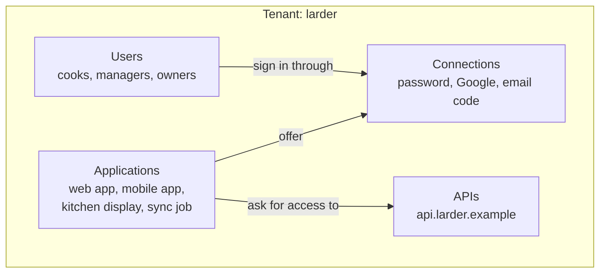

Chapter 2 · The basics

# The moving parts

Identity systems have a small vocabulary, and most confusion comes from not having it straight. Here are the nouns, using Larder as the example.

## Five nouns

**A tenant** is a self-contained world: its own users, its own settings, its own login page. Nothing leaks from one tenant to another. Larder starts with a single tenant called `larder`. Chapter 13 covers why you might want more.

**An application** is a piece of software that asks AuthHero to log people in. The standards call it a *client*, and you will see both words. Larder has several:

| Application | Kind | What makes it different |
| --- | --- | --- |
| The web app | Regular web application | Has a server that can keep a secret |
| The mobile app | Native | Runs on a device the user controls, so it cannot keep a secret |
| The kitchen display | Native, using the device flow | No keyboard, no browser |
| The supplier sync job | Machine-to-machine | No human involved at all |

Each application gets a **client ID**, a list of URLs it may send users back to, and settings for what it is allowed to request.

**A connection** is a way of proving who you are. Email and password is one connection. "Continue with Google" is another. A code sent by email is a third. A tenant has a set of connections, and each application chooses which of them to offer.

**A user** is a person. A user belongs to a tenant, arrives through a connection, and has a profile: email, name, picture, and two bags of custom data. `user_metadata` is for things the user may edit, such as a preferred language. `app_metadata` is for things only you may edit, such as which pricing plan they are on.

**An API** is something worth protecting. The standards call it a *resource server*. Larder's API lives at `https://api.larder.example`, and that URL doubles as its identifier. Each API defines **scopes**, which are the things a caller can be allowed to do: `read:stock`, `write:stock`.

Three more nouns turn up later. **Organizations** group users into customer companies, **roles** bundle permissions together, and **sessions** remember that a browser is logged in. They get their own chapters.

If you are coming from Auth0, these are exactly the same objects with the same names and the same JSON shapes. That is deliberate.

## Three front doors

AuthHero is one HTTP application with three distinct surfaces. Knowing which one you are talking to clears up a lot.

**The Auth API** is what applications talk to. It is the OAuth 2.0 and OpenID Connect part:

| Endpoint | What it is for |
| --- | --- |
| `GET /authorize` | Start a login |
| `POST /oauth/token` | Swap a code, a refresh token or client credentials for tokens |
| `GET /userinfo` | Ask who a token belongs to |
| `GET /v2/logout` | End the session |
| `GET /.well-known/openid-configuration` | A machine-readable description of all of the above |
| `GET /.well-known/jwks.json` | The public keys for checking token signatures |

**Universal Login** is what people see. When `/authorize` decides that someone needs to prove who they are, it sends the browser to a set of pages under `/u2/`: enter your email, enter your password, enter the code from your phone. These pages belong to AuthHero, not to your application, which is why your application never touches a password. Chapter 8 is about them.

**The Management API** is what administrators and scripts talk to. It lives under `/api/v2/` and is a plain REST API over everything in this chapter: `/api/v2/users`, `/api/v2/clients`, `/api/v2/connections`, `/api/v2/roles`, and so on. It follows Auth0's Management API, so existing tooling works.

There is also an **admin dashboard**, a web interface for people who would rather click than `curl`. It is worth knowing that the dashboard is an ordinary application. It has no private back door. It logs you in through `/authorize` like everything else and then calls the Management API with the token it got. Anything the dashboard can do, your own scripts can do too.

## What a fresh install contains

A new AuthHero installation creates one of each thing, enough to log in:

| Thing | Value |
| --- | --- |
| Tenant | The one you name in the setup wizard (`control_plane` under Docker) |
| Connection | `Username-Password-Authentication` |
| Application | `Default Application`, client ID `default` |
| API | The Management API itself |
| Role | `Tenant Admin`, with every management permission |
| User | You, holding that role |

Notice that the Management API shows up in the list as an API like any other, and that your right to use it comes from a role. AuthHero protects itself with the same mechanisms it offers you.

## A translation table

Three vocabularies describe the same things, and documentation switches between them freely.

| OAuth and OIDC say | AuthHero and Auth0 say | Meaning |
| --- | --- | --- |
| Authorization server, OpenID provider | Tenant | The thing that issues tokens |
| Client, relying party | Application | Software that asks for a login |
| Resource server | API | Something that accepts tokens |
| Resource owner, end-user | User | The person |
| Identity provider (upstream) | Connection | Where the user's identity comes from |

With the nouns in place, we can follow a login from the first click to the moment the application knows who it is dealing with.

**In the docs:** [Entities](/entities/) · [The AuthHero Package](/architecture/authhero-package) · [API Reference](/api/overview)
