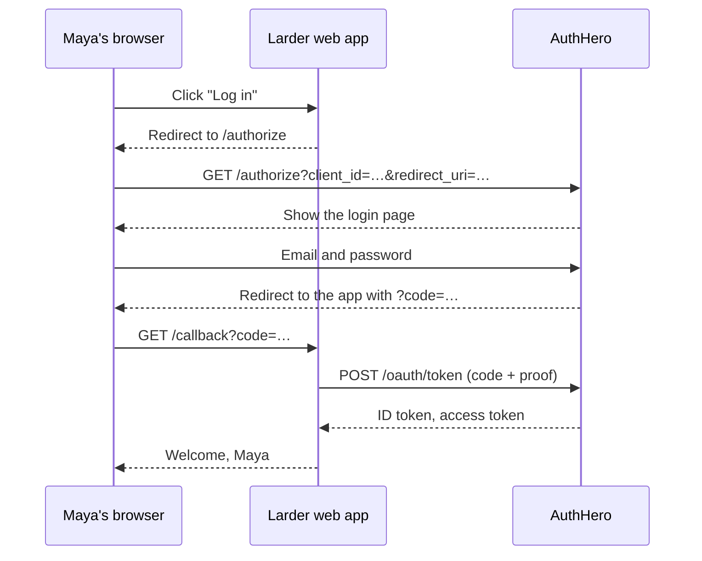

<p class="book-kicker">Chapter 3 · The basics</p>

# The login dance

A login through an identity provider is a short sequence of redirects. It looks fussy the first time you see it, but every step is there because someone once got burned without it. The sequence has a name, the **authorization code flow**, and almost every login in this book is a variation of it.

## The whole thing in one picture

Maya is a cook. She opens Larder's web app and clicks *Log in*.



Read it as three movements.

**Out.** The app does not ask Maya for her password. It sends her browser to AuthHero's `/authorize` endpoint with a few parameters: who is asking (`client_id`), where to send her afterwards (`redirect_uri`), and what it wants to know (`scope`).

**In the middle.** AuthHero takes over the browser tab. Maya types her password into a page served by AuthHero, on AuthHero's domain. The app is not part of this conversation at all.

**Back.** AuthHero redirects the browser to the app's `redirect_uri` with a short-lived, single-use **authorization code** in the URL. The app's server takes that code and calls `/oauth/token` directly, server to server, to exchange it for tokens.

Why the extra hop? Why not put the tokens straight into the redirect? Because URLs end up in browser history, server logs and referrer headers. A code that works once, for a few minutes, and only together with a second piece of proof is a much smaller thing to leak than a token.

## The supporting cast

A real `/authorize` request looks like this:

```text
https://auth.larder.example/authorize
  ?client_id=larder-web
  &response_type=code
  &redirect_uri=https://app.larder.example/callback
  &scope=openid profile email
  &state=af0ifjsldkj
  &code_challenge=E9Melhoa2OwvFrEMTJguCHaoeK1t8URWbuGJSstw-cM
  &code_challenge_method=S256
```

Each parameter closes a specific hole.

| Parameter | What it protects against |
| --- | --- |
| `redirect_uri` | Sending the code to an attacker's site. AuthHero only redirects to URLs registered on the application. |
| `state` | Someone tricking Maya's browser into finishing a login they started. The app makes up a random value, and checks that the same value comes back. |
| `code_challenge` | A stolen code. This is **PKCE**, explained below. |
| `scope=openid` | Nothing, but it is what turns a plain OAuth request into an OpenID Connect one, so that an ID token comes back. |
| `nonce` | An ID token being replayed. The app sends a random value and checks that the token contains it. |

**PKCE** (say "pixy") deserves a paragraph, because it is what makes the flow safe for apps that cannot keep a secret. Before redirecting, the app invents a random string, the *verifier*, and sends only its SHA-256 hash, the *challenge*, to `/authorize`. When it later exchanges the code, it sends the verifier itself. AuthHero hashes it and compares. Someone who intercepts the code has seen only the hash and cannot produce the verifier, so the code is useless to them.

A server-side app proves itself at the token endpoint with a client secret. A mobile app or a single-page app has nowhere to hide a secret, so PKCE is its only proof, and AuthHero insists on it: a code exchange with neither a secret nor a matching verifier is rejected.

## What AuthHero does at each step

Behind those redirects, a small number of endpoints each own one job.

**`/authorize` is the front desk.** It validates the request: does this client exist, is the redirect URL on its list, are the parameters sane? Then it creates a **login session**, a short-lived record of this one login attempt, and decides where to send the browser. Usually that is the login page. If Maya is already logged in, it may be straight back to the app (chapter 5). If the request names a connection, such as `connection=google-oauth2`, it is straight to Google.

**The login pages collect proof.** They check the password or the code, write the result onto the login session, and pass the browser on. They never issue tokens.

**`/authorize/resume` is the only way out.** Every login, whichever route it took, ends here. This endpoint checks whether anything is still owed, such as a second factor or an unverified email, and sends the browser back to the right page if so. Once everything is in order it sets the session cookie, creates the authorization code and redirects to the app.

**`/oauth/token` hands out tokens.** It checks the code, the client's proof and the PKCE verifier, and answers with JSON.

The login session is the thread that ties these together. Its ID travels along as the `state` query parameter on AuthHero's own pages, and it moves through a small state machine as the login progresses: pending, then authenticated, perhaps awaiting MFA or awaiting email verification, then completed. Having one place that says where a login stands is what lets AuthHero insert steps into the middle of the dance without the app noticing. The app sent the browser away and got a code back. It has no idea whether that involved one screen or six.

A few safety nets are built in. Codes work once. If the same code is presented twice, AuthHero assumes it was stolen and revokes the refresh tokens that came from that login. And a login session that sits unfinished simply expires.

## You will rarely write this yourself

Nobody should hand-roll the redirects, the random values and the hashing in production. A client library does all of it, and because AuthHero follows Auth0's API, Auth0's libraries work as they are: `auth0-spa-js`, `auth0-react`, `nextjs-auth0` and others. You point them at your AuthHero domain. Any standards-based OpenID Connect library works too, since everything it needs to know is published at `/.well-known/openid-configuration`.

Still, it pays to have clicked through the dance once by hand. [Your First Login](/first-login) does exactly that with a browser and `curl`, and when something goes wrong in production, it will go wrong at one of the steps above.

So the app now holds tokens. The next chapter opens them up.

**In the docs:** [Authentication Flows](/features/authentication-flows) · [Login Flow (endpoints)](/architecture/login-flow) · [Authorize endpoint](/api/authorize) · [RFC 7636 (PKCE)](/standards/rfc-7636)
