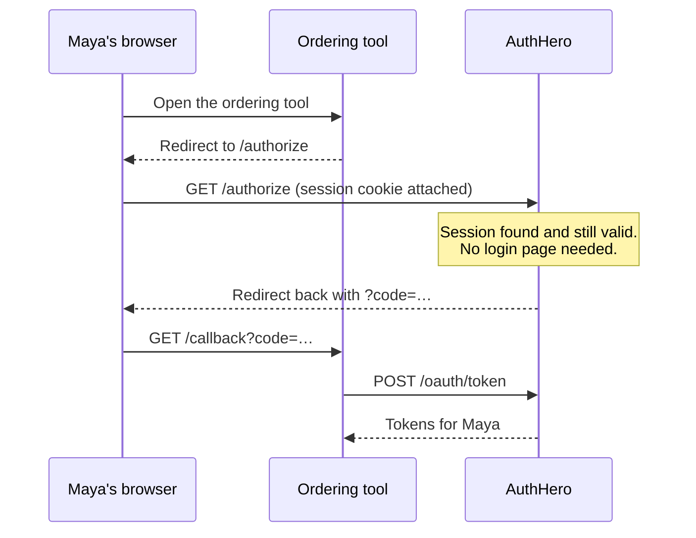

Chapter 5 · The basics

# Sessions, single sign-on and logging out

Tokens live in applications. But there is one more piece of memory in the system, and it lives with AuthHero: the fact that this browser already proved who it is.

## The cookie that makes it one login

When Maya finishes logging in, AuthHero does two things at the last step. It sends her back to the app with a code, as we saw. It also sets a cookie in her browser, on AuthHero's own domain. The cookie holds the ID of a **session**, a record on the server that says: this browser belongs to Maya, and she proved it at 08:14 with a password.

Ten minutes later Maya opens Larder's ordering tool, a different application with a different client ID. It sends her to `/authorize`, same as before. This time her browser brings the cookie along. AuthHero finds the session, sees that it is still valid, and redirects her straight back with a code. No login page appears. From Maya's side, she clicked a link and was simply in.

That is all **single sign-on** (SSO) is. Nothing is shared between the applications. They each run the full dance and get their own tokens. The only shared thing is the cookie at the identity provider.

## Two kinds of session

AuthHero keeps two records, and the names are close enough to trip over.

| | Login session | Session |
| --- | --- | --- |
| Represents | One attempt to log in to one application | One signed-in browser |
| Lives for | Minutes | Days or weeks |
| Created | Every time `/authorize` is called | When a user actually authenticates |
| Remembers | The request: client, redirect URL, scopes, progress | The user, the device, and which applications have used it |

Every trip through `/authorize` makes a new login session. If the user has to prove who they are, a session is created at the end and linked to it. If a valid session already exists, the new login session is linked to that instead. The session also keeps a list of every application that has ridden on it, which matters when it ends.

How long a session lasts is a tenant setting, again with an absolute limit and an idle limit.

## Asking quietly

An application sometimes wants to know whether the user is still logged in without interrupting them. A single-page app does this when the page reloads and its tokens are gone from memory.

Adding `prompt=none` to the `/authorize` request means: answer from the session, and do not show any pages. If a valid session exists, tokens come back. If not, the answer is the error `login_required`, and the app knows to send the user through a normal login. Other possible answers are `interaction_required`, when a second factor is owed, and `consent_required`, which chapter 9 explains. This is called **silent authentication**.

## Logging out is three different things

"Log out" sounds like one action. In a system with several applications it is at least three, and AuthHero treats them separately on purpose.

**Ending the application's own session.** The app forgets its tokens. This is the app's business, and AuthHero is not involved.

**Ending the AuthHero session.** The app sends the browser to `/v2/logout` (or the standard OpenID Connect version, `/oidc/logout`). AuthHero ends the session and clears the cookie, so the next `/authorize` shows the login page. It then redirects to a URL of the application's choosing, which must be on its list of allowed logout URLs.

**Telling the other applications.** Maya logged out of the web app, but the ordering tool still has tokens and still thinks she is there. If an application registers a **back-channel logout** URL, AuthHero calls it, server to server, with a signed message saying that this session is over. The application can then discard its own session for her.

## What ends what

Here is the part worth reading twice. Ending a session and revoking tokens are not the same act.

| Event | Browser session | Refresh tokens |
| --- | --- | --- |
| User logs out | Ended | Keep working |
| Session expires | Ended | Keep working |
| Admin revokes the session | Ended | Revoked |
| Admin blocks the user | All ended | All revoked |

The rule behind the table: **revocation couples, lifetime does not.** A refresh token is designed to outlive the browser session it came from. Otherwise every mobile app would log its user out whenever a browser tab timed out. So when a session ends for ordinary reasons, the refresh tokens carry on with their own clocks. When someone with authority *revokes* a session, the message is different, "this should stop now", and the refresh tokens go with it.

And access tokens? An API verifies those without asking AuthHero, so they cannot be recalled. They last until they expire. If "stop now" has to mean within minutes, give the API a short access token lifetime.

Blocking a user is the big red button. Every login method is refused, every session and refresh token is revoked, and the account is otherwise left intact.

## When the cookie cannot follow

SSO rides on a cookie, and a cookie belongs to one domain. Applications that reach AuthHero through the same domain share a session. But suppose Larder buys a company whose shop runs on a completely different domain, with its own login address. The browser has no cookie there, and Maya would be asked to log in a second time.

**Session transfer** covers that gap. The first application asks AuthHero for a one-time token on Maya's behalf and passes it along in the link. The second application includes it in its `/authorize` request, and AuthHero logs her in without a prompt. The token is valid for 60 seconds, works once, and only between applications that have both been set up for it. The same mechanism carries a user from a native mobile app into a web page without a second login.

That completes the basics: the dance, the tokens, and the session behind them. Part two looks at the step we have skipped over so far, the one in the middle where Maya actually proves who she is.

**In the docs:** [Session Management](/features/session-management) · [Session Cookies](/architecture/session-cookies) · [Session Transfer](/features/session-transfer) · [Back-Channel Logout](/standards/backchannel-logout)
