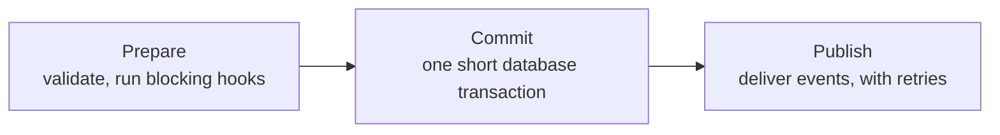

<p class="book-kicker">Chapter 11 · Making it yours</p>

# Your own rules

Every identity system eventually meets a sentence that begins with "except". Anyone may sign up, *except* people with throwaway email addresses. Tokens contain the standard claims, *except* that ours also need the restaurant's region. Users may delete their account, *except* that we have to tell the billing system first.

No product can anticipate all of these. What it can do is leave well-placed openings where your own logic runs. AuthHero has several, and choosing the right one is most of the work.

## The openings

| Mechanism | Where your logic lives | Best for |
| --- | --- | --- |
| **Actions** | JavaScript stored in the tenant, run in a sandbox | Rules that change often, or differ per tenant |
| **Config hooks** | Functions in your own deployment's code | Logic that needs your database or internal services |
| **Webhooks** | A URL of yours that AuthHero calls | Telling another system that something happened |
| **Forms and flows** | Configuration, no code | Asking the user for something, or simple automations |
| **Templates** | Built in, just switch on | Common behaviour such as account linking |

## Actions

An **Action** is a small piece of JavaScript attached to a **trigger**, a named moment in the life of a login or a user. AuthHero runs it when that moment arrives and hands it two things: an `event` describing what is happening, and an `api` object for changing the outcome.

Here is the region claim from the opening:

```js
exports.onExecutePostLogin = async (event, api) => {
  const region = event.user.app_metadata?.region;
  if (region) {
    api.accessToken.setCustomClaim("https://larder.example/region", region);
  }
};
```

And the sign-up rule:

```js
exports.onExecutePreUserRegistration = async (event, api) => {
  if (event.user.email?.endsWith("@mailinator.com")) {
    api.access.deny("signup_blocked", "Please use a permanent email address.");
  }
};
```

This is the same format Auth0 uses, so Actions written for Auth0 generally run unchanged.

The triggers cover the whole lifecycle:

| Moment | Typical use |
| --- | --- |
| Before a user is created | Refuse the sign-up, or set initial metadata |
| After a user is created | Create the matching record in your CRM |
| After login, before tokens | Add claims, require MFA, deny access |
| Whenever a token is issued | Add claims that must survive a refresh |
| Before a login screen is shown or submitted | Redirect elsewhere, or block a screen |
| Before and after a user is updated or deleted | Veto the change, or clean up afterwards |
| When an email or SMS needs sending | Deliver it yourself |

Around the code itself there is the tooling you would expect. Actions are **versioned**, so a bad deploy is one click away from the previous one. Secrets are stored separately from the code and can be written but never read back. There is a test runner, and every execution is recorded together with whatever the Action printed to the console, which is how you find out why Tuesday's sign-ups failed.

Three limits are worth knowing before you design around Actions:

- They run in a **sandbox** with no access to AuthHero's database. An Action can call out with `fetch`, and that is all.
- There is a five-second timeout, and npm packages cannot be loaded.
- Something has to execute them. On Cloudflare each Action runs in its own isolate. There is also a local executor meant for development. Without an executor, Actions are stored but do not run.

## When your code fails

A login system has to decide what to do when your Action throws an error or hangs. AuthHero decides per trigger, and the pattern makes sense once you see it:

- Triggers whose only job is to **veto** a change, such as blocking a user update or a deletion, **fail closed**. If the check cannot run, the operation is refused.
- Triggers on the busy paths, which are sign-up, login and token issuance, **fail open**. A bug in your claim logic should not lock every user out of the product.

You can mark any individual binding on those paths as fail-closed when its job is security and not decoration. If an Action exists to keep banned users out, a crash should not let them in.

## Config hooks

Because AuthHero is a library, you can also pass plain functions when you start it:

```ts
const { app } = init({
  dataAdapter,
  hooks: {
    onExecutePostLogin: async (event, api) => {
      const plan = await billing.getPlan(event.user.user_id);
      api.accessToken.setCustomClaim("https://larder.example/plan", plan);
    },
  },
});
```

It is the same shape as an Action with none of the sandbox. The function runs inside your process with everything your process can reach. The price is that changing it means deploying. Use config hooks for logic that belongs to the platform and Actions for logic that belongs to a tenant.

## Webhooks

A **webhook** is the lightest option. You register a URL against a trigger, and AuthHero sends it a `POST` with the details. It suits "tell the data warehouse that someone signed up", where the receiving system is already built and you would prefer not to write any code inside the identity provider at all.

## Deliveries that do not get lost

Anything that happens *after* the fact, such as a post-registration webhook, raises an awkward question. What if your endpoint is down at the moment the user signs up?

AuthHero handles every write in three phases:



**Prepare** runs the checks and the hooks that are allowed to say no. This can take a while, since your webhook might be slow, so no database transaction is open yet. **Commit** writes the user, and in the same transaction writes a note that an event needs delivering. This record is called an **outbox**. **Publish** works through the outbox afterwards, retrying with growing pauses when a destination fails, and setting an event aside for inspection if it never succeeds.

The result is that a user cannot be created without the event being recorded, and your slow endpoint never holds a database lock. The outbox is something you switch on, and the guarantee is strongest on databases that support transactions.

## Flows: logic without code

Not every rule deserves JavaScript. A **flow** is a list of ready-made steps: update a field on the user, check that an email address is real and not disposable, redirect the browser somewhere. Flows are configured through the dashboard or the API, and they pair naturally with the forms from chapter 8. A form collects an answer, and a flow acts on it.

## Sending messages your own way

Chapter 8 mentioned that emails go through a configured provider. If yours is not supported, or messages must pass through an internal service, bind an Action to the **custom email provider** or **custom phone provider** trigger. AuthHero still decides what to send and when. Your Action receives the finished message and delivers it. It can also tell AuthHero to drop the message, retry later, or fall back to the default provider.

## Walking in someone else's shoes

One more rule that many products need: support staff who can see what a customer sees. **Impersonation** lets a user who holds the `users:impersonate` permission log in and then choose another user to continue as. The login completes with the other person's identity, and the resulting access tokens are limited to one hour.

It is powerful, so it is opt-in and tied to a permission you grant deliberately. Give it to as few people as you gave the `access:all_organizations` permission in the last chapter.

**In the docs:** [Actions](/features/actions) · [Hooks](/features/hooks) · [Hooks & Outbox Pipeline](/architecture/hooks-pipeline) · [Flows](/features/flows) · [Custom Email & SMS Providers](/features/custom-email-and-sms-providers) · [Impersonation](/features/impersonation)
