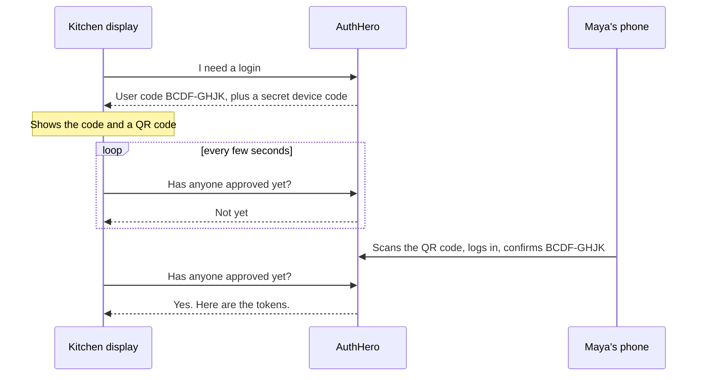

Chapter 12 · Making it yours

# Beyond the browser tab

The login dance in chapter 3 assumed a web application with a server behind it. Plenty of software is not shaped like that. Each of the clients below changes one assumption, and each has a flow designed for exactly that change.

## The app that lives in the browser

A single-page app has no server of its own to keep secrets or tokens. Everything it holds, a script running on the same page can reach. On top of that, browsers have spent years restricting the cross-site cookies that older techniques relied on. There are three workable designs, in rough order of preference.

**A small backend holds the tokens.** This is the *backend-for-frontend* pattern. A thin server runs the login dance and keeps the tokens in a server-side session. The browser gets an ordinary first-party cookie that scripts cannot read. It is the most secure option and the one least affected by browser privacy changes.

**The app holds the tokens in memory, with a rotating refresh token.** There is no backend to run, and this is what most client libraries do by default. Rotation from chapter 4 is what makes it defensible.

**The app asks silently when it needs to.** This is `prompt=none` from chapter 5, in a hidden frame. It works well when the app and the login page share a parent domain, and badly otherwise.

Whichever you choose, AuthHero requires PKCE for these clients, and checks calls from the browser against the origins you have listed on the application.

## The app in someone's pocket

A native mobile app also cannot keep a secret, since anyone can unpack the binary. So it is the authorization code flow with PKCE again, with two differences.

The login page opens in the **system browser**, not in a web view inside the app. That keeps passwords out of the app's reach, and lets the user's existing session, password manager and passkeys work. The redirect back uses a link the phone's operating system routes to the app, such as `com.larder.app:/callback`.

And because nobody wants to log in on their phone every day, mobile apps lean on refresh tokens with long lifetimes. Turn rotation on for them.

## The screen with no keyboard

The display on Larder's kitchen wall shows incoming orders. It has no keyboard, and nobody is going to type a password on it with greasy fingers.

The **device flow** moves the typing to a device that is good at it.

The display asks AuthHero for a pair of codes. It shows the short one on screen, as text and as a QR code, and keeps the long one to itself. Maya scans the QR code with her phone, logs in there in the usual way, with MFA if it applies, and confirms that the code on her phone matches the one on the wall. Meanwhile the display keeps asking, and after her approval the answer contains tokens.

The same flow is what a command-line tool uses when it says "open this URL and enter this code".

## The machine

A scheduled job, a backend service or a script authenticates as itself with client credentials. Chapter 9 covered this. It is listed here to complete the set.

## When you already have a login

Sometimes there is a perfectly good login system in place and you cannot replace it this quarter. Perhaps Larder acquired a product with its own user table, and that product now has to call an API that only accepts AuthHero tokens.

**Custom token exchange** bridges the two. The other system's backend signs a short-lived JWT saying "this is user 4812". It presents that at AuthHero's token endpoint and receives AuthHero tokens for the matching user. No login page appears, because that user already logged in somewhere you trust.

You define the trust in a profile: which signing keys to accept, which issuer and audience the incoming token must have, and how its subject maps to a user. The simple case, a standard signed JWT, needs no code at all. For anything stranger, an Action makes the decision. By default each incoming token is accepted only once, and what comes back is tokens, not a browser session.

## Developers you have never met

A platform grows when other people can build on it. For that, they need to register applications, and you do not want that to mean an email thread about redirect URLs.

AuthHero offers three levels of openness.

**Invite a developer.** You generate a time-limited link and send it to, say, the agency building a customer's ordering app. They open it, fill in their app's name and callback URLs on a page with your branding, and receive a client ID. The link is the only credential they ever hold. You decided the important things beforehand: the app type, the login methods, whether users see a consent screen. Later you can send an edit link, or revoke access entirely.

**Let software register itself.** *Dynamic client registration* is the standard for this. An application posts a description of itself and gets credentials back. You gate it with tokens that restrict what a registration may ask for.

**Let the client describe itself.** With *client ID metadata documents*, an application's client ID is simply a URL where a small JSON file describes it. Once the feature is enabled for a tenant, AuthHero fetches and validates the document when the application shows up. Nothing is registered in advance.

That third option exists largely because of the next kind of client.

## AI agents

An AI assistant that acts for a person is one more application asking for access to something, and the same rules should apply to it: the human logs in, the human consents, and the token is limited.

The *Model Context Protocol* (MCP) is how assistants connect to tools, and it uses OAuth for this. AuthHero implements the pieces it expects. An assistant can discover where to send the user to log in. It can identify itself by a metadata URL, without anyone creating a client for it first. And the token it receives is bound to the one server it asked about and is refused everywhere else.

AuthHero also uses these pieces itself. It can expose its own Management API as an **MCP server**, so that an administrator can ask an assistant "which of our applications still allow password login?" and get an answer. Access follows the administrator's own permissions, secrets are redacted before they reach the model, and the server is read-only.

## One diagram to keep

| The client is… | Use |
| --- | --- |
| A web app with a server | Authorization code, with a client secret or key |
| A single-page app | Authorization code with PKCE, ideally behind a small backend |
| A mobile or desktop app | Authorization code with PKCE in the system browser, rotating refresh tokens |
| A TV, kiosk or command-line tool | Device flow |
| A backend job | Client credentials |
| A system with its own login | Custom token exchange |
| Someone else's software | Any of the above, after consent |

**In the docs:** [SPA Authentication](/features/spa-authentication) · [Device Authorization](/features/device-authorization) · [Custom Token Exchange](/features/custom-token-exchange) · [Developer App Invites](/features/developer-app-invites) · [Dynamic Client Registration](/standards/rfc-7591) · [CIMD](/standards/cimd) · [Management API MCP Server](/features/mcp-server)
