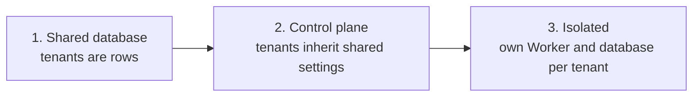

Chapter 13 · Running it

# Many tenants

Until now Larder has lived in a single tenant. That holds for a long time. Then one of these happens:

- You want a staging environment that cannot possibly touch production users.
- You launch a second product whose users are unrelated to the first.
- A large customer wants the login under their own brand, on their own domain, with nothing shared.
- Your product is itself a platform, and each of *your* customers needs a login system for *their* customers.

Each of those is a reason for another **tenant**.

## What a tenant isolates

A tenant is a wall. On one side of it sit a set of users, applications, connections, APIs, roles, organizations, signing keys, branding and settings. Nothing on the other side can see them. The same email address can exist in two tenants as two unrelated people with different passwords.

AuthHero was built this way from its first line. Every query carries a tenant ID and every Management API token is valid for one tenant, so there is no "global" mode to forget to switch off. A single-tenant installation is just a multi-tenant one that happens to have one.

## How a request finds its tenant

Before any login logic runs, AuthHero has to know which tenant a request is for. It works that out from the address the request arrived at:

| The request arrives at | Tenant |
| --- | --- |
| `login.luigis.example`, a custom domain registered for a tenant | That tenant |
| `luigis.auth.larder.example`, a subdomain of your auth domain | `luigis` |
| The Management API, with a `tenant-id` header | The one named |
| An installation with only one tenant | That one |

The result is that a tenant's addresses belong to it. Tokens issued through `login.luigis.example` say so in their issuer, and the session cookie lives on that domain.

## Three strengths of wall

How far apart tenants really live is a deployment decision, and AuthHero offers three levels. Each builds on the one before, so you move up only when you need to.

**1. Shared database.** One deployment and one database. Tenants are separated by the tenant ID on every row. This is the default and it is enough whenever you own every tenant yourself, for instance one per environment or one per product.

**2. A control plane.** Once there are dozens of tenants, configuring Google login forty times gets old. The multi-tenancy package introduces a **control-plane tenant** that the others inherit from. A tenant with no Google connection of its own falls back to the control plane's. Shared roles and API definitions are copied into each tenant as read-only entries. You set things up once, and a tenant overrides only what it wants to differ on.

The control plane is also where tenants are managed. Each tenant is represented there by an organization, and membership of that organization is what gives an administrator access to the tenant. It is the mechanism from chapter 10, turned on AuthHero itself.

**3. Full isolation.** For tenants that must not share anything, including the blast radius of a bug, each one gets its own Worker and its own database on Cloudflare's Workers for Platforms. A thin dispatcher in front reads the hostname and hands the request to the right one. A runaway query, a bad deploy or a custom build in one tenant cannot affect another.

| | Shared database | Control plane | Isolated |
| --- | --- | --- | --- |
| Separation | By tenant ID | By tenant ID | Separate process and database |
| Shared settings | None | Inherited when read | Copied in at rollout |
| Per-tenant code | No | No | Yes |
| An outage affects | Everyone | Everyone | One tenant |
| Good for | Your own tenants | Many customers | Large or untrusted tenants |

## A domain of their own

A customer who wants the login page at `login.luigis.example` and not on your domain is asking for a **custom domain**. It matters more than it looks. The domain is what users see in the address bar when they type their password, what appears as the issuer in tokens, and where the session cookie lives.

Setting one up means the customer points a DNS record at you, a certificate is issued for the hostname, and AuthHero records which tenant the hostname belongs to. On Cloudflare the certificate step is automated through an adapter.

Custom domains have a habit of growing. Once Luigi's has `luigis.example` pointed at you, they would like the account page and the checkout under the same name too, even though those are different applications hosted elsewhere. AuthHero's **proxy** package handles this. It sits in front, works out the tenant from the hostname, and routes each path to the right place: login paths to AuthHero, `/account` to one app, `/checkout` to another. Because everything now shares one origin, the session cookie works across all of it.

## Packing up a tenant

Tenants need to move: staging to production, one region to another, an old deployment to a new one. AuthHero can **export** a tenant as a single file of JSON lines and **import** it somewhere else.

The export holds what is durable, meaning configuration and users. It leaves out what is temporary, such as sessions and login attempts. Password hashes are included only if the caller holds a specific extra permission, since a file of hashes deserves care.

It is not a backup in the database sense. It is a way to carry a tenant from one place to another, and a readable record of how the tenant was configured.

## The rule of thumb, again

Chapter 10 ended with a comparison that is worth repeating now that both halves are on the table.

| You have… | Use |
| --- | --- |
| Customer companies using one product | One tenant, many **organizations** |
| Separate environments, products or brands | Separate **tenants** |
| Customers who need their own login system | A tenant each, with a **control plane** |
| Customers who need their own everything | **Isolated** tenants |

Start with the first row that fits. Moving down the table later is an operational project, but your applications will not need to change, because from their side a tenant is only ever a domain name.

**In the docs:** [Multi-Tenancy architecture](/architecture/multi-tenancy) · [Tenants](/entities/configuration/tenants) · [Multi-Tenant SaaS guide](/features/multi-tenant-saas) · [Multi-Tenancy Package](/customization/multi-tenancy/) · [Custom Domain Setup](/deployment/custom-domain-setup) · [Proxy Package](/customization/proxy/) · [Tenant Export & Import](/features/tenant-export-import)
