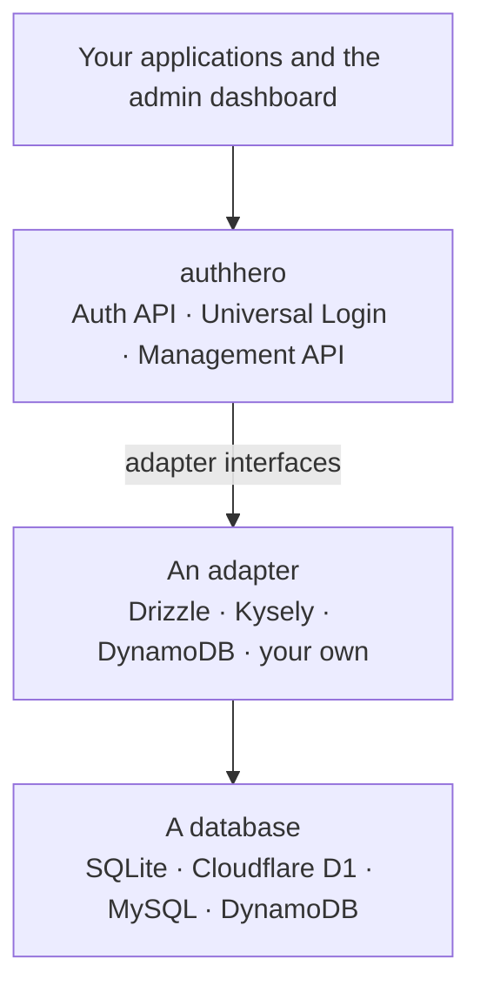

<p class="book-kicker">Chapter 14 · Running it</p>

# Where it runs

Thirteen chapters about what AuthHero does, and nothing yet about what it *is*. The answer is short, and it explains most of the design.

## A library, not a server

AuthHero is an HTTP application written with [Hono](https://hono.dev), a small web framework that runs on nearly every JavaScript runtime. You do not install AuthHero and then configure it. You import it, hand it a database, and get an application back:

```ts
import { init } from "authhero";
import createAdapters from "@authhero/drizzle";

const { app } = init({
  dataAdapter: createAdapters(db),
});

export default app;
```

That is a complete identity provider. The `app` it returns serves all three surfaces from chapter 2: the Auth API, Universal Login and the Management API.

Being a library has consequences that a packaged server cannot offer:

- **It can live inside your existing application.** Mount it under a path of a server you already run, and login is one deployment, not two.
- **Configuration is code.** The hooks in chapter 11, a custom email sender, your own middleware: all are arguments to `init()`, type-checked and version-controlled like everything else.
- **It goes where JavaScript goes.** There is no bundled runtime to host.

## The database is somebody else's job

The core package contains no SQL. Whenever it needs to read a user or store a session, it calls a method on an **adapter**, an object that implements a published set of TypeScript interfaces, one per kind of thing: users, clients, connections, sessions, keys and several dozen more.



The adapters that ship with AuthHero:

| Adapter | Stores data in | Typical home |
| --- | --- | --- |
| `@authhero/drizzle` | SQLite, Cloudflare D1 | New deployments. This is the primary adapter. |
| `@authhero/kysely-adapter` | MySQL (PlanetScale), SQLite | Existing MySQL deployments |
| `@authhero/aws-adapter` | DynamoDB | AWS Lambda |
| `@authhero/cloudflare-adapter` | Not a database: custom domains, caching, logs, rate limiting | Alongside a database adapter on Cloudflare |

Two things follow from the arrangement.

**You can write your own.** If your company runs everything on a database that is not listed, implement the interfaces and AuthHero works on it.

**Adapters stack.** Because an adapter is just an object, one can wrap another. A *passthrough* adapter writes to two databases at once and reads from one, which is how you move from one database to another without a maintenance window. A *fallback* adapter reads from a second source when the first has no answer. An *encrypting* adapter wraps any of them, as the next chapter shows. Caching is the same trick again.

## Picking a home

The same code runs in all of these. What changes is the adapter and a few lines of glue.

**Docker with SQLite.** One container, one file on a volume. There are no external services to run, and it is the simplest route to production for a single product. Give it a domain and a TLS certificate and you are done.

**Cloudflare Workers with D1.** AuthHero runs at the edge, in the data center closest to each user, and scales without your involvement. A login is a short burst of small requests, which suits that model well. This is also where the fully isolated tenants from chapter 13 are available.

**AWS Lambda with DynamoDB.** For teams whose world is AWS. There is a ready template built on SST.

**Inside your own Node.js server.** As above: one more route in a process you already operate.

**On your laptop.** A SQLite file and a local HTTPS certificate. Everything in this book can be tried without an account anywhere.

## From nothing to running

Nobody should assemble those lines of glue by hand the first time. The `create-authhero` command generates a working project for the home you choose:

```bash
npm create authhero@latest my-auth
```

It asks which template you want, whether to include the admin dashboard and whether to enable multiple tenants. Then it installs dependencies, sets up the database and starts the server.

| Template | Gives you |
| --- | --- |
| `local` | A Node.js server on SQLite, serving HTTPS locally |
| `cloudflare` | A Worker on D1, with optional CI workflows |
| `aws-sst` | Lambda on DynamoDB |
| `cloudflare-control-plane`, `cloudflare-wfp-dispatcher`, `cloudflare-wfp-tenant` | The three parts of an isolated multi-tenant platform |
| `proxy` | The custom-domain proxy on its own |

The result is ordinary code in your own repository, which you then change as you see fit.

## Looking after it

Once it runs, there are four ways to manage what is inside.

**The admin dashboard.** A web interface for tenants, applications, connections, users, roles, organizations, branding, Actions and logs. It can be served by the same deployment at `/admin`, and one dashboard can switch between several AuthHero installations.

**The Management API.** Everything the dashboard does, as REST. Because it follows Auth0's API, the official Auth0 client libraries work against it.

**Terraform.** The same compatibility means the official `auth0/auth0` Terraform provider can manage AuthHero. Set its `domain` to your AuthHero host, and applications, connections, roles and the rest become reviewed, versioned configuration:

```hcl
provider "auth0" {
  domain        = "auth.larder.example"
  client_id     = var.client_id
  client_secret = var.client_secret
}
```

**An AI assistant**, through the read-only MCP server from chapter 12, when you want an answer and not a dashboard.

## Two chores

A service that issues short-lived things accumulates expired ones: used codes, finished login sessions, old sessions and tokens. AuthHero does not delete these on its own. A scheduled job has to call **retention** once a day:

```ts
import { runRetention } from "authhero";

await runRetention({ dataAdapter });
```

If you use the outbox from chapter 11, a second scheduled job should run its relay, so that events which failed on the first attempt are retried even when no new requests arrive.

Projects generated by `create-authhero` come with retention already scheduled. Both chores are mentioned here because they are what a hand-built deployment most often forgets, and the symptom, a database that grows without end, takes months to notice.

**In the docs:** [Architecture](/architecture/) · [Adapters](/architecture/adapters) · [Deployment](/deployment/) · [Create AuthHero CLI](/packages/create-authhero/) · [Admin Dashboard](/apps/admin/) · [Terraform](/auth0-comparison/terraform) · [Data Retention](/deployment/data-retention)
