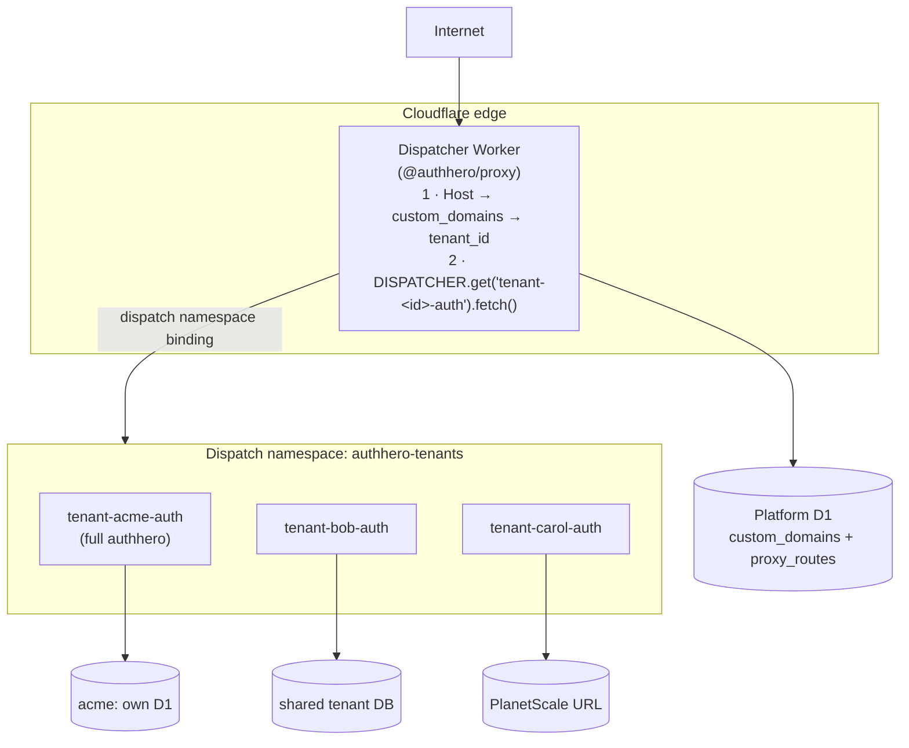
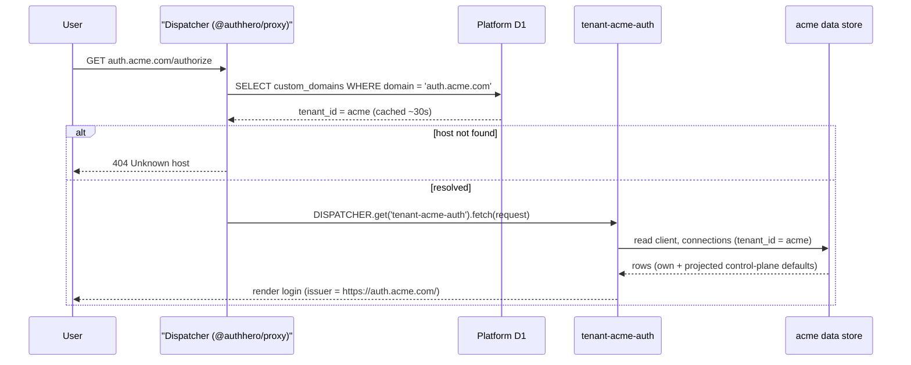
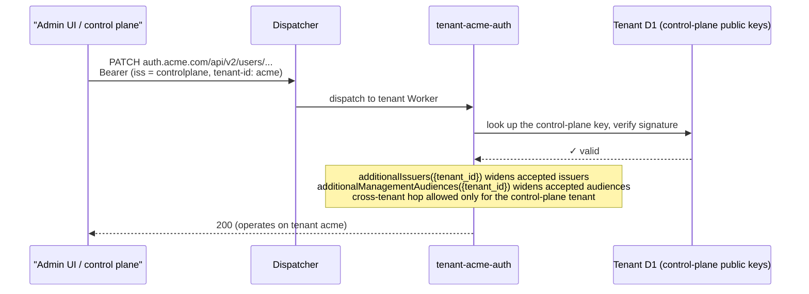

# Cloudflare Workers for Platforms

Deploy authhero as a multi-Worker SaaS platform where each tenant (publisher) gets their own isolated authhero Worker, fronted by a thin dispatcher Worker that routes by custom domain.

::: tip Two-tier deploy, plus an optional control plane
WFP authhero is **two Workers**, not one:

1. **Dispatcher** — `@authhero/proxy` running as a Worker. Resolves the request's `Host` header to a tenant, then dispatches to that tenant's Worker via a [dispatch namespace](https://developers.cloudflare.com/cloudflare-for-platforms/workers-for-platforms/configuration/dispatch-namespaces/) binding.
2. **Tenant Worker(s)** — the full `authhero` app, one Worker per tenant, deployed _into_ the dispatch namespace.

A third Worker, the **control plane**, is optional. It holds the config your tenants inherit and pushes it into each tenant's own database, so tenants with their own D1 share config without ever reading another database. It is [Step 4](#step-4-add-a-control-plane-and-sync-config).
:::

## When to use this

The default [Cloudflare Workers deployment](./cloudflare) runs **one** Worker that handles all tenants — tenant resolution happens inside the Worker via the `Host` header. That's the right answer for most deployments.

Reach for Workers for Platforms (WFP) when you need:

- **Per-tenant isolation** — a bug or runaway request in one tenant's Worker can't affect others
- **Per-tenant code customization** — publishers can ship modified authhero builds (different login flow, custom hooks, special branding logic) without a shared deploy
- **Per-tenant resource limits** — CPU time and subrequest caps applied per script
- **A true platform model** — you operate authhero as a SaaS where customers deploy "into" you

The trade-off is operational cost: every tenant has its own deployment lifecycle (worker upload, optional D1 creation, secrets distribution, custom domain wiring). The rest of this page is the playbook for that lifecycle.

## Architecture



The dispatcher reads only the **platform D1** to resolve a host; each tenant
Worker talks to whatever store its own bindings point at (own D1, a shared DB,
or PlanetScale). Three different data stores can be in play:

| Store                | Lives in      | Owned by           | Purpose                                                                |
| -------------------- | ------------- | ------------------ | ---------------------------------------------------------------------- |
| **Platform D1**      | one shared DB | dispatcher         | `custom_domains` + `proxy_routes` — how the dispatcher resolves hosts  |
| **Per-tenant D1**    | optional      | each tenant Worker | the tenant's own `users`, `clients`, `sessions`, etc. — full isolation |
| **Shared tenant DB** | one shared DB | all tenant Workers | shared `users`, `clients`, etc. — only data partition is `tenant_id`   |

You can mix: tenant A uses its own fresh D1, tenant B uses the shared tenant DB, tenant C uses a PlanetScale URL. Each tenant Worker's `wrangler` bindings dictate what _it_ talks to; the dispatcher only cares about the platform D1.

### Request flow

A user request never reaches a tenant Worker directly — it always lands on the
dispatcher first, which resolves the host and forwards into the namespace:



The dispatcher caches host → tenant resolution (~30s by default), so a newly
inserted `custom_domains` row may 404 until the cache expires — see
[Troubleshooting](#unknown-host-404-from-the-dispatcher).

## Prerequisites

- A Cloudflare account on the **Workers for Platforms** plan (dispatch namespaces require this)
- [Wrangler CLI](https://developers.cloudflare.com/workers/wrangler/install-and-update/) v3.50+
- Node.js 20+

Verify your account has the WFP plan:

```bash
npx wrangler dispatch-namespace create test-namespace-delete-me
npx wrangler dispatch-namespace delete test-namespace-delete-me
```

If the first command 403s, your account doesn't have WFP enabled — talk to your Cloudflare account team.

## Step 1: Set up the dispatcher

### 1.1 Scaffold

```bash
npm create authhero@latest auth-dispatcher -- \
  --template=cloudflare-wfp-dispatcher
cd auth-dispatcher
```

The scaffolder installs the dependencies for you. If you passed `--skip-install`, run `npm install` now.

This produces a thin Worker built on `@authhero/proxy` that uses the `dispatch_namespace` handler. Key files:

- `src/index.ts` — Worker entrypoint; wraps `createProxyDataAdapter` with a default dispatch fallback
- `src/types.ts` — `Env` with `AUTH_DB: D1Database` and `DISPATCHER: DispatchNamespace`
- `wrangler.toml` — declares the dispatch namespace binding and the platform D1
- `wrangler.local.toml` — a copy of `wrangler.toml` that holds your real IDs (gitignored). The scaffolder creates it; the `db:migrate:remote` and `deploy` scripts use it

### 1.2 Create the dispatch namespace

```bash
npx wrangler dispatch-namespace create authhero-tenants
```

The name you pick here must match the `namespace = "..."` field in `wrangler.toml` and the `--dispatch-namespace=...` flag you'll use when deploying tenant Workers.

### 1.3 Create the platform D1

```bash
npx wrangler d1 create authhero-platform-db
```

The output gives you a `database_id`. Open the `[[d1_databases]]` block that already exists in `wrangler.local.toml` and change **only** `database_name` and `database_id`:

```toml
[[d1_databases]]
binding = "AUTH_DB"                       # keep as is
database_name = "authhero-platform-db"    # was "authhero-db"
database_id = "abc123def456..."           # was "local" — paste here
migrations_dir = "node_modules/@authhero/drizzle/drizzle"   # keep as is
```

::: warning Don't paste the block wrangler prints
`wrangler d1 create` prints its own `[[d1_databases]]` snippet, but it derives the binding name from the database name (for example `authhero_platform_db`). The dispatcher reads `env.AUTH_DB`, so the binding must stay `AUTH_DB`. Pasting wrangler's block as-is leaves the dispatcher without a database.
:::

::: tip Why a separate "platform" D1
The dispatcher only needs `tenants`, `custom_domains`, and `proxy_routes` rows. Keeping it on its own D1 means tenant Workers can't accidentally corrupt the routing table, and per-tenant deploys can't trip dispatcher rate limits.

You _can_ point the dispatcher at the same shared DB the tenants use — the schema is a superset — but separation is cleaner if you have the operational budget for two D1s.
:::

### 1.4 Apply the schema

The dispatcher template ships migrations from `@authhero/drizzle`:

```bash
npm run db:migrate:remote
```

That runs `wrangler d1 migrations apply AUTH_DB --remote --config wrangler.local.toml` against the platform D1. After it finishes you should see the `tenants`, `custom_domains`, and `proxy_routes` tables (plus the rest of the authhero schema — harmless on the platform D1).

For local development:

```bash
npm run db:migrate:local      # apply to local sqlite emulation of D1
```

### 1.5 Deploy the dispatcher

```bash
npm run deploy
```

The dispatcher is now live at `auth-dispatcher.<your-account>.workers.dev` (wrangler prints the exact URL at the end of the deploy) but it has no tenants and won't resolve any hosts yet. You can sanity-check it:

```bash
curl -i https://auth-dispatcher.<your-account>.workers.dev
# HTTP/1.1 404
# Unknown host
```

That's the expected response — no `custom_domains` row matches `auth-dispatcher.<your-account>.workers.dev`.

## Step 2: Pick a tenant storage model

Each tenant Worker needs a database. You have three reasonable options; the choice affects the tenant's `storage_kind` field (see [Tenant lifecycle fields](#tenant-lifecycle-fields) below) and the bindings on that tenant's `wrangler.toml`.

### Option A: own D1 (full isolation)

Each tenant gets its own freshly-created D1, seeded with a fresh schema and an initial admin user. Best isolation, highest setup cost.

- **Pros**: complete data isolation; per-tenant backup/restore; per-tenant migration scheduling
- **Cons**: hits Cloudflare's D1-per-account limits; CI / provisioning has more moving parts
- **`storage_kind`**: `own_d1`

```toml
# tenant-acme/wrangler.toml
[[d1_databases]]
binding = "AUTH_DB"
database_name = "authhero-tenant-acme"
database_id = "xyz789..."
```

### Option B: existing D1 (shared per-batch)

A pre-created D1 (e.g. the platform D1, or one shared D1 per region) hosts data for many tenants, partitioned by `tenant_id` in every query. Same model the single-Worker deploy uses.

- **Pros**: one D1 to operate; simple migrations
- **Cons**: no data-layer isolation; one tenant's noisy queries impact all
- **`storage_kind`**: `existing_d1`

```toml
# tenant-acme/wrangler.toml
[[d1_databases]]
binding = "AUTH_DB"
database_name = "authhero-platform-db"
database_id = "abc123..."  # same as the dispatcher's D1
```

### Option C: PlanetScale (cross-region MySQL)

Tenant Workers connect to a shared PlanetScale URL via a secret binding instead of a D1. Good when D1's per-region replication isn't enough.

- **Pros**: cross-region writes; mature MySQL tooling
- **Cons**: extra network hops from the Worker; no data isolation
- **`storage_kind`**: `shared_planetscale`

```toml
# tenant-acme/wrangler.toml
# No D1 binding. PlanetScale URL is a secret instead.
```

```bash
echo "mysql://..." | wrangler secret put --name=tenant-acme-auth PLANETSCALE_URL
```

::: warning Pick early
The storage decision shapes the bundle you upload (the bindings in the Worker's `wrangler.toml` differ). It's far easier to pick once per tenant than to migrate later.
:::

## Step 3: Onboard a tenant

For each publisher, four discrete steps. We'll use `acme` as the example tenant id and `auth.acme.com` as their domain.

### 3.1 Create the tenant row + custom domain in the platform D1

Either via the management API of a [control plane](/customization/multi-tenancy/control-plane) or by direct SQL. The dispatcher from Step 1 has no management API, so if you haven't deployed a control plane, use direct SQL:

::: code-group

```bash [Via management API]
curl -X POST https://admin.authhero.example.com/api/v2/tenants \
  -H "Authorization: Bearer $CONTROL_PLANE_TOKEN" \
  -H "Content-Type: application/json" \
  -d '{
    "id": "acme",
    "friendly_name": "Acme Inc",
    "audience": "https://auth.acme.com/",
    "sender_name": "Acme",
    "sender_email": "noreply@acme.com",
    "deployment_type": "wfp",
    "storage_kind": "own_d1",
    "bundle_configuration": "authhero-drizzle-d1",
    "worker_version": "v1.0.0"
  }'

curl -X POST https://admin.authhero.example.com/api/v2/custom-domains \
  -H "Authorization: Bearer $CONTROL_PLANE_TOKEN" \
  -H "Content-Type: application/json" \
  -d '{
    "tenant_id": "acme",
    "domain": "auth.acme.com",
    "type": "auth0_managed_certs"
  }'
```

```sql [Direct SQL]
-- Run against the platform D1 via
-- `wrangler d1 execute authhero-platform-db --remote --config wrangler.local.toml --file tenant.sql`
INSERT INTO tenants (id, friendly_name, audience, sender_name, sender_email,
                     deployment_type, storage_kind, bundle_configuration,
                     worker_version, provisioning_state, created_at, updated_at)
VALUES ('acme', 'Acme Inc', 'https://auth.acme.com/', 'Acme', 'noreply@acme.com',
        'wfp', 'own_d1', 'authhero-drizzle-d1', 'v1.0.0', 'pending',
        '2026-06-06T00:00:00Z', '2026-06-06T00:00:00Z');

INSERT INTO custom_domains (custom_domain_id, tenant_id, domain, "primary", status,
                            type, created_at, updated_at)
VALUES ('cd-acme', 'acme', 'auth.acme.com', 1, 'ready', 'auth0_managed_certs',
        '2026-06-06T00:00:00Z', '2026-06-06T00:00:00Z');
```

:::

::: tip control-plane scope
The `POST /api/v2/tenants` endpoint requires the `create:tenants` scope **and** must be called against a control-plane tenant (see [Multi-Tenancy](/architecture/multi-tenancy)). Use a service-account token, never a tenant token.
:::

::: warning direct SQL does not register the hostname
The management-API path above goes through the control plane's Cloudflare
adapter, which registers the hostname in the CF-for-SaaS zone. The direct-SQL
path only writes a row — Cloudflare never hears about the domain and it will
not route, no matter how the DNS is pointed. Use direct SQL only for a domain
you have already registered in the zone by hand.
:::

::: tip platform subdomains need no custom_domains row
The `custom_domains` entry above is for the tenant's **branded** domain
(`auth.acme.com`). The tenant's platform subdomain (`acme.token.example.com`)
routes without one: wrap the control plane's tenants adapter with
`wrapTenantsAdapterWithWfpKvPublish` and its dispatch route is derived from the
tenant row and published to KV automatically when provisioning completes — see
[Proxy → Deployment topologies → WFP tenant subdomains](/customization/proxy/deployment#wfp-tenant-subdomains).
:::

### 3.2 Create the tenant's D1 (only if `storage_kind = "own_d1"`)

```bash
npx wrangler d1 create authhero-tenant-acme
```

Then record the `database_id` Cloudflare returned in the platform D1:

```bash
npx wrangler d1 execute authhero-platform-db --remote --config wrangler.local.toml \
  --command "UPDATE tenants SET d1_database_id = 'xyz789...' WHERE id = 'acme';"
```

::: warning Don't use the binding wrangler prints
`wrangler d1 create` prints a `[[d1_databases]]` block with a binding derived from the database name (`authhero_tenant_acme`). The tenant Worker reads `env.AUTH_DB`, so keep `binding = "AUTH_DB"` and only copy the name and id into the tenant project in [3.4](#_3-4-deploy-the-tenant-worker-into-the-dispatch-namespace).
:::

The schema is applied in [3.4](#_3-4-deploy-the-tenant-worker-into-the-dispatch-namespace), once the tenant project exists: `wrangler d1 migrations apply` reads the database from that project's Wrangler config.

::: tip One-shot schema apply
Running `wrangler d1 migrations apply` does ~40 sequential HTTP calls to D1 (one per migration), which takes 8-20 seconds. If you need it faster — for programmatic provisioning from a Worker — bundle all migrations into a single SQL file and POST once to `/accounts/:id/d1/database/:dbid/query`. D1's query endpoint accepts multi-statement bodies up to ~100KB; the current drizzle bundle is ~916 lines and fits comfortably. The API-driven provisioner (see [API-driven provisioning](#api-driven-provisioning)) applies migrations through this HTTP endpoint rather than wrangler.
:::

For Options B/C, skip this step — the data store already exists.

### 3.3 Seed initial data

The tenant's D1 needs at least one admin user, a signing key, and the management API resource server. The `seed()` helper exported from `authhero` is idempotent and does this in one call. The scaffolded `cloudflare` template ships a one-shot seed Worker (`src/seed.ts`) that calls it.

This step needs the tenant project from [3.4](#_3-4-deploy-the-tenant-worker-into-the-dispatch-namespace), so do steps 1–3 there (scaffold, point it at the D1, apply the schema) first, then come back here before you deploy.

The scaffolded seed creates a tenant called `main` and derives the issuer from the request URL, which is `localhost` when you run it through `wrangler dev`. Change the `seed()` call in `src/seed.ts` to match your tenant:

```typescript
const result = await seed(adapters, {
  adminUsername,
  adminPassword,
  issuer: "https://auth.acme.com/", // the tenant's public URL, not localhost
  tenantId: "acme",
  tenantName: "Acme Inc",
  isControlPlane: false,
  clientId: "default",
});
```

Then run it against the tenant's remote D1:

```bash
cd tenant-acme/
npx wrangler dev src/seed.ts --remote --config wrangler.local.toml

# in another terminal — choose your own password, don't keep the default
curl "http://localhost:8787/?username=admin@acme.com&password=<password>"
```

The response contains `"success":true` when the seed completed.

::: warning Don't use `npm run seed:remote`
The script starts `wrangler dev` without `--config wrangler.local.toml`, so it never sees your real `database_id`.
:::

The seed encrypts credential fields with the `ENCRYPTION_KEY` in `.dev.vars`. The deployed Worker must use the **same** key — see [3.5](#_3-5-wire-secrets).

### 3.4 Deploy the tenant Worker into the dispatch namespace

1. Scaffold a tenant Worker from the [`cloudflare` template](./cloudflare) into a new directory, outside the dispatcher project:

   ```bash
   cd ..   # out of the dispatcher project
   npm create authhero@latest tenant-acme -- --template=cloudflare --yes --skip-migrate
   ```

   `--yes` takes the scaffolder's defaults, which are the answers this guide assumes: **single-tenant** (this Worker serves one tenant, so don't enable multi-tenant mode), the admin UI at `/admin`, no GitHub CI, dependencies installed, dev server not started. `--skip-migrate` is there because the scaffolder's own migration only creates a local emulation of D1; the real schema goes in at step 4. Without `--yes` you are asked each of these in turn, and those are the answers to give.

2. In the new project's `wrangler.local.toml`, point the existing `[[d1_databases]]` block at the tenant's data store (see [Step 2](#step-2-pick-a-tenant-storage-model)). For `own_d1`, change only `database_name` and `database_id` and keep `binding = "AUTH_DB"`.
3. Remove the `[triggers]` section (`crons = [...]`). Workers in a dispatch namespace never receive scheduled events.
4. Apply the schema to the tenant's D1 (takes 8–20 seconds):

   ```bash
   cd tenant-acme/
   npm run db:migrate:remote
   ```

5. Seed the database ([3.3](#_3-3-seed-initial-data)).
6. Deploy into the namespace:

   ```bash
   node copy-assets.js
   npx wrangler deploy --config wrangler.local.toml \
     --dispatch-namespace=authhero-tenants \
     --name=tenant-acme-auth \
     --secrets-file .dev.vars
   ```

The script name **must** match the dispatcher's template — by default `tenant-<tenant_id>-auth`. Override the template globally via the `SCRIPT_NAME_TEMPLATE` env var on the dispatcher (supports `{tenant_id}`, `{custom_domain_id}`, `{domain}`, `{host}` placeholders).

After a successful deploy, mark the tenant ready:

```sql
UPDATE tenants
SET provisioning_state = 'ready',
    provisioning_state_changed_at = '2026-06-06T00:00:00Z',
    worker_script_name = 'tenant-acme-auth'
WHERE id = 'acme';
```

### 3.5 Wire secrets

The tenant Worker needs at least `ENCRYPTION_KEY` (for at-rest encryption of credential fields) and any provider API keys it uses.

`wrangler secret put` has no `--dispatch-namespace` option, so it can't target a Worker inside a dispatch namespace. Pass the secrets when you deploy instead, with `--secrets-file` (the deploy command in [3.4](#_3-4-deploy-the-tenant-worker-into-the-dispatch-namespace)). The file is a `.env`-style list, and secrets you leave out of later deploys are kept:

```bash
# .dev.vars (or any .env-style file you pass to --secrets-file)
ENCRYPTION_KEY=...
EMAIL_API_KEY=...
```

The scaffolder generates an `ENCRYPTION_KEY` per project in `.dev.vars`. Use that same key for the deploy: the seed in [3.3](#_3-3-seed-initial-data) encrypted its data with it, and a different key cannot decrypt that data. Keep one key per tenant — don't share it across the namespace. See [Encryption at Rest](/security/encryption-at-rest).

If tenants will register their **own** custom domains through their management
API (rather than you creating them centrally, as in [3.1](#_3-1-create-the-tenant-row-custom-domain-in-the-platform-d1)),
the tenant Worker also needs to know where the control plane is:

```toml
# tenant-acme/wrangler.toml
[vars]
CONTROL_PLANE_URL = "https://auth.example.com"

# Optional but recommended — keeps the call inside Cloudflare instead of
# looping out over the public edge and back in through the dispatcher.
[[services]]
binding = "CONTROL_PLANE"
service = "authhero-control-plane"
```

A tenant Worker cannot register a custom hostname itself: that needs Cloudflare
account credentials, which by design live only on the control plane, and a
hostname can only be claimed by one tenant, which only the control plane can
see. So `POST /api/v2/custom-domains` on a tenant Worker writes **through** the
control plane and mirrors the result into the tenant's own D1. **Without
`CONTROL_PLANE_URL` the tenant Worker refuses custom-domain writes (`501`)**
rather than storing a row Cloudflare never hears about; reads keep working. See
[Custom domains: the control plane is authoritative](/customization/multi-tenancy/control-plane#custom-domains-the-control-plane-is-authoritative).

### 3.6 Point the tenant's custom domain at the dispatcher

In the Cloudflare Dashboard:

1. Workers & Pages → **dispatcher** Worker → Settings → Domains & Routes → Add → Custom domain → `auth.acme.com` (the zone must be in the same Cloudflare account; use **Add**, not Add Route, so Cloudflare creates the DNS record for you)
2. Cloudflare provisions the TLS certificate and points DNS

Or in `wrangler.toml`:

```toml
[[routes]]
pattern = "auth.acme.com/*"
zone_name = "acme.com"
```

### 3.7 Verify

```bash
curl https://auth.acme.com/.well-known/openid-configuration
```

Expected: a JWKS issuer document with `"issuer": "https://auth.acme.com/"`. If you get `Unknown host` (404), the `custom_domains` row isn't in place or the dispatcher hasn't picked it up yet (it caches host resolutions for 30s by default — see [the proxy cache config](/customization/proxy/caching)).

::: tip Next: add a control plane
Steps 3.1–3.6 are the manual flow, and the tenant you just deployed works on its own. To share config between tenants (connections with their secrets, hooks, actions, resource servers, branding), add a control plane in [Step 4](#step-4-add-a-control-plane-and-sync-config). To also create tenants through `POST /api/v2/tenants`, register customers' own domains in Cloudflare for SaaS, and have the platform create each tenant's D1 and Worker for you, see [Control plane](/customization/multi-tenancy/control-plane) and [API-driven provisioning](#api-driven-provisioning).
:::

## Step 4: Add a control plane and sync config

A **control plane** is a separate authhero Worker that owns the config tenants inherit. A `sync-defaults` operation resolves a tenant's parent chain and **pushes** the result through the dispatch namespace into the tenant Worker, which writes it to its own D1. The tenant never reads the control plane at request time.

This step adds a control plane to what you built in Steps 1–3 and syncs the `acme` tenant, which has its own D1. It needs `create-authhero` 0.51.1 or later, whose templates install `authhero` 9.28.3, `@authhero/multi-tenancy` 15.5.0 and `@authhero/cloudflare-adapter` 4.1.2 or later. Earlier versions have problems this step runs into (see [Troubleshooting](#sync-troubleshooting)).

The examples use `control.example.com` for the control plane and `https://token.example.com/` as its issuer apex. Use your own zone.

### 4.1 Scaffold the control plane

```bash
npx create-authhero@latest control-plane \
  --template cloudflare-control-plane --package-manager npm \
  --yes --skip-migrate
cd control-plane/
```

The scaffold has already written `wrangler.local.toml` and `.dev.vars`, with generated values for `ENCRYPTION_KEY`, `CONTROL_PLANE_ENCRYPTION_KEY` and `WFP_INTERNAL_SYNC_SECRET`. `npm run setup` never overwrites them. The last two are **shared**: every tenant Worker must hold the same values ([4.6](#_4-6-redeploy-the-tenant-worker-from-the-wfp-tenant-template)).

### 4.2 Point it at the platform D1

The control plane and the dispatcher share the platform D1: the control plane writes `tenants`, `custom_domains` and `proxy_routes`, and the dispatcher reads them. In `wrangler.local.toml`, set `database_name` and `database_id` on **both** `[[d1_databases]]` entries (they are the same database, `AUTH_DB` and `AUTH_DB_CONTROL_PLANE_MIGRATIONS`), and keep the bindings as they are. Then apply the schema:

```bash
npm run db:migrate:remote                 # core schema; applies anything Step 1.4 did not
npm run db:migrate:control-plane:remote   # tenant operations and rollouts
```

The tenant-operation and rollout tables are a second migration set that only exists on a control plane. It is tracked in its own table (`d1_migrations_control_plane`), so the two sets never re-apply each other. Without it, `POST /api/v2/tenants/{id}/operations` fails.

### 4.3 Choose the control plane's host and issuer

Give the control plane its own host, for example `control.example.com`, attached to **the control plane Worker** in [4.5](#_4-5-deploy), not to the dispatcher. Then set an issuer apex that is **not** that host, in `wrangler.local.toml`:

```toml
[vars]
ISSUER = "https://token.example.com/"
```

`token.example.com` does not need to exist in DNS. It is the apex under which tenant subdomains (`{tenant}.token.example.com`) are recognised. A request's tenant is found from its host, and hosts under the `ISSUER` apex are read as tenant subdomains and never looked up as custom domains. Leave `ISSUER` unset and the request's own host becomes the apex, so the control plane's tenant can only be found while the database holds a single tenant. Every WFP tenant adds a row, so it stops resolving as soon as you add one (the symptom is a SQL error on `tenants.id = ?`, see [Troubleshooting](#sync-troubleshooting)).

### 4.4 Seed the control plane tenant

The seed derives the issuer from the URL it runs on, which is `localhost` under `wrangler dev`. In `src/seed.ts`, replace the line that builds `issuer` with the control plane's real URL:

```typescript
const issuer = "https://control.example.com/";
```

Then seed the remote D1:

```bash
npx wrangler dev src/seed.ts --remote --config wrangler.local.toml

# in another terminal — choose your own password
curl "http://localhost:8787/?username=admin&password=<password>"
```

The response has `"success":true` and includes the `clientSecret` of the `default` client (you need it in [4.7](#_4-7-get-a-management-token)). Don't use `npm run seed:remote`: it starts `wrangler dev` without `--config wrangler.local.toml`.

Now register the control plane's host so requests to it resolve to the `control_plane` tenant. Do this after the seed, since the row references the tenant. Save the statement as `control-domain.sql`:

```sql
INSERT INTO custom_domains (custom_domain_id, tenant_id, domain, "primary", status,
                            type, created_at, updated_at)
VALUES ('cd-control-plane', 'control_plane', 'control.example.com', 1, 'ready',
        'self_managed_certs', '2026-06-06T00:00:00Z', '2026-06-06T00:00:00Z');
```

```bash
npx wrangler d1 execute authhero-platform-db --remote --config wrangler.local.toml --file control-domain.sql
```

The dispatcher never sees this host, because the domain goes straight to the control plane Worker, so the row does not affect routing.

### 4.5 Deploy

The template already binds the dispatch namespace from [Step 1.2](#_1-2-create-the-dispatch-namespace):

```toml
[[dispatch_namespaces]]
binding = "DISPATCHER"
namespace = "authhero-tenants"
```

```bash
node copy-assets.js
npx wrangler deploy --config wrangler.local.toml --secrets-file .dev.vars
```

Then, in the Cloudflare Dashboard: Workers & Pages → **authhero-control-plane** → Settings → Domains & Routes → Add → Custom domain → `control.example.com`. Verify:

```bash
curl https://control.example.com/.well-known/openid-configuration
```

Expected: `"issuer": "https://control.example.com/"`. A custom domain takes a minute to get its certificate, and a request right after a deploy can still reach the previous version.

### 4.6 Redeploy the tenant Worker from the WFP tenant template

The Worker from [3.4](#_3-4-deploy-the-tenant-worker-into-the-dispatch-namespace) serves logins fine, but only the `cloudflare-wfp-tenant` template receives pushes: it is built with `createWfpTenantApp`, which mounts `/internal/sync-config` and holds the key ring that reads the control plane's secrets. Scaffold it and deploy over the same script:

```bash
npx create-authhero@latest tenant-acme-v2 \
  --template cloudflare-wfp-tenant --package-manager npm \
  --yes --skip-migrate
cd tenant-acme-v2/
```

Keep the tenant's data and keys, and set what the Worker needs to know about the control plane:

1. In `wrangler.local.toml`, point `[[d1_databases]]` at the tenant's D1 (the same `database_name` and `database_id` as in 3.4, `binding = "AUTH_DB"`), and set `[vars]`:

   ```toml
   [vars]
   ISSUER = "https://auth.acme.com/"                       # the tenant's own issuer, as seeded in 3.3
   TENANT_ID = "acme"
   CONTROL_PLANE_TENANT_ID = "control_plane"
   CONTROL_PLANE_ISSUER = "https://control.example.com/"   # the host the control plane mints tokens on
   ```

2. In `.dev.vars`, keep the tenant's **existing** `ENCRYPTION_KEY` (the one the seed in 3.3 used, since its rows are encrypted with it), and replace the generated `CONTROL_PLANE_ENCRYPTION_KEY` and `WFP_INTERNAL_SYNC_SECRET` with the control plane's values.

3. Deploy over the same script name. The tenant's D1 is untouched, so there is nothing to migrate or seed again:

   ```bash
   node copy-assets.js
   npx wrangler deploy --config wrangler.local.toml \
     --dispatch-namespace=authhero-tenants \
     --name=tenant-acme-auth \
     --secrets-file .dev.vars
   ```

Check that the tenant still answers with the same issuer and key: `curl https://auth.acme.com/.well-known/openid-configuration`.

### 4.7 Get a management token

Operations are created through the control plane's management API, which needs a token. The seed creates the `default` client with a secret but no client grant to the management API, so create one for a first token:

```sql
INSERT INTO client_grants (id, tenant_id, client_id, audience, scope, created_at, updated_at)
VALUES ('cg-bootstrap', 'control_plane', 'default', 'urn:authhero:management',
 '["read:tenants","update:tenants","read:tenant_operations","create:tenant_operations","read:rollouts","create:rollouts","update:rollouts","read:logs","read:connections","create:connections","update:connections"]',
 '2026-06-06T00:00:00Z', '2026-06-06T00:00:00Z');
```

Save it as `grant.sql` and run it with `npx wrangler d1 execute authhero-platform-db --remote --config wrangler.local.toml --file grant.sql`, then ask for a token with the client secret from the seed response:

```bash
TOKEN=$(curl -s -X POST https://control.example.com/oauth/token \
  -d "grant_type=client_credentials&client_id=default&client_secret=<clientSecret>&audience=urn:authhero:management" \
  | node -e 'let s="";process.stdin.on("data",d=>s+=d).on("end",()=>console.log(JSON.parse(s).access_token))')
```

If you did not keep the secret, it is in the `clients` table, encrypted with `ENCRYPTION_KEY`: read it with `SELECT client_secret FROM clients WHERE tenant_id='control_plane' AND client_id='default'` and decrypt it with `npm run decrypt -- "<enc:v1:… value>"`.

::: warning A bootstrap grant is not a production client
This gives the default client full management scopes on the control plane. Use it to get started, then create a dedicated machine-to-machine client with only the scopes it needs, rotate its secret, and delete `cg-bootstrap`.
:::

### 4.8 Sync a tenant

Publish something to share. A connection on the control plane with `scope: "shared"` is inherited by tenants; `override: "secrets"` lets a tenant supply its own client secret:

```bash
curl -X POST https://control.example.com/api/v2/connections \
  -H "authorization: Bearer $TOKEN" -H "content-type: application/json" \
  -d '{"name":"google-oauth2","strategy":"google-oauth2",
       "options":{"client_id":"<id>","client_secret":"<secret>"},
       "scope":"shared","override":"secrets"}'
```

Run the sync as a **dry run** first:

```bash
curl -X POST https://control.example.com/api/v2/tenants/acme/operations \
  -H "authorization: Bearer $TOKEN" -H "content-type: application/json" \
  -d '{"kind":"sync-defaults","input":{"dry_run":true}}'
```

The operation's `result` lists `changes` as `entity:key` (never content or secrets) and per-entity counts. Expect `connection:google-oauth2:google-oauth2` as added. A row the tenant already has with the same strategy and name is not replaced: it is listed as `skip … (the tenant has its own)`. Run it without `dry_run` to apply. The secret reaches the tenant as ciphertext tagged with the `cp` key, which the tenant Worker reads with `CONTROL_PLANE_ENCRYPTION_KEY`.

Check the result on both sides:

```bash
# the control plane's view: the hash the tenant applied, and whether the chain moved since
curl https://control.example.com/api/v2/tenants/acme/config-sync -H "authorization: Bearer $TOKEN"

# the hard check: a dry run against the tenant's own rows, through the dispatch namespace
curl https://control.example.com/api/v2/tenants/acme/config-sync/verify -H "authorization: Bearer $TOKEN"
```

`verify` answers `"ok": true` with an empty `differences` list when the tenant's rows match what its parents publish. `GET …/config-sync` shows `drifted: false` with `config_sync_hash` equal to `expected_hash` once the tenant is `synced` (next step).

### 4.9 Flip to `synced`, and roll back

A tenant starts as `inherit-on-read`. To make the synced copy the source of truth, switch it from the control plane:

```bash
curl -X PATCH https://control.example.com/api/v2/tenants/settings \
  -H "authorization: Bearer $TOKEN" -H "tenant-id: acme" \
  -H "content-type: application/json" -d '{"config_sync":"synced"}'
```

Switch back with `{"config_sync":"inherit-on-read"}`. The runbook [Migrating a tenant to synced config](/customization/multi-tenancy/config-sync-migration) walks through dry run, verify, the flip and a rollback window for a tenant with real traffic.

::: warning Needs `authhero` 9.28.3 or later
Before 9.28.3, a partial `PATCH /tenants/settings` such as the flip above also reset the tenant's `deployment_type` to `shared`, and with it every later sync went in-process against the control plane's own database instead of to the tenant Worker.
:::

### 4.10 Things to know

- **The tenant's `/internal/*` routes are reachable through the dispatcher.** `/internal/sync-config`, `/internal/detach` and the others are served by the tenant Worker under its public hostname. They are authenticated by `WFP_INTERNAL_SYNC_SECRET` as a bearer token and answer `401` when it is not set, so treat the secret like a credential: long, random, identical on the control plane and every tenant, and rotated with the Workers.
- **Two syncs of one tenant are not ordered.** If an operator and a rollout sync the same tenant at once, the tenant can end up with the older block. `verify` shows it. Avoid running a manual sync against a tenant a rollout is working on, and run `verify` after an overlap.
- **The template does not schedule rollouts.** Manual syncs and `POST /rollouts` work; automatic drift repair needs `reconcileConfigDrift` and `advanceRollouts` wired into `scheduled()` in `src/index.ts`. See [Tenant operations](/customization/multi-tenancy/tenant-operations#what-starts-a-rollout).
- **Only the control plane tenant's secrets are tagged `cp`.** If an intermediate parent (a tenant between the control plane and a tenant with its own Worker) publishes secrets, the tenant cannot read them and the push is refused with `422 sync_config_key_ring` before anything is written. Return `"cp"` for that tenant from `resolveEncryptKeyId` in `src/index.ts` and save its secrets again.
- **A control plane that encrypts needs `storedDataAdapter`.** The template passes its raw adapter to `initMultiTenant` as `storedDataAdapter`, so the sync status hashes config the way a push copies it. If you wire your own control plane, do the same ([Tenant operations](/customization/multi-tenancy/tenant-operations#syncing-a-tenant-s-config-sync-defaults)).

## Admin dashboard

There are two ways to give people an admin UI on a Workers-for-Platforms setup. Most platforms want the first, which is also how Auth0 works: one dashboard, and customers are members of their tenant.

|                 | Central admin (recommended)                                                                  | Tenant's own admin                                                   |
| --------------- | -------------------------------------------------------------------------------------------- | -------------------------------------------------------------------- |
| Hosted          | Once, as a static app (for example Cloudflare Pages), next to the control plane              | In every tenant Worker, at `/admin` on the tenant's host             |
| Sign-in         | An account on the control plane, made a member of the tenant                                 | A user of the tenant itself, against the tenant's issuer             |
| API calls       | To the control plane with a `tenant-id` header, forwarded to the tenant Worker               | Straight to the tenant Worker, same origin                           |
| Tenant verifies | A control-plane token, with the control plane's public key synced into its database          | Its own tokens, with its own key                                     |
| Good for        | A platform that runs its customers' tenants and wants one place for access, logs and support | A single tenant that should be self-contained, with no control plane |

### Central admin

`@authhero/admin` is a static single-page app. Build it once with the control plane as its fixed domain, and host it anywhere that serves static files:

| Variable               | Value                                                                      |
| ---------------------- | -------------------------------------------------------------------------- |
| `VITE_AUTH0_DOMAIN`    | The control plane's issuer, for example `https://token.example.com`        |
| `VITE_AUTH0_API_URL`   | The control plane's management API, for example `https://auth.example.com` |
| `VITE_AUTH0_CLIENT_ID` | A client on the control plane that the admin signs in with                 |

With the domain fixed, the admin opens on the control plane's tenant list and never asks for a domain. It sends every tenant-scoped call to the control plane with a `tenant-id` header. For that to work:

1. The admin's host is in the control plane's allowed origins, and its `/auth-callback` is an allowed callback of the client above.
2. The control plane forwards calls for a `wfp` tenant to that tenant's Worker with `createWfpForwardMiddleware`. The control-plane template does not include it yet, so mount it in your own app; see [Control-plane admin tokens](#control-plane-admin-tokens).
3. The tenant Worker can verify the control plane's token. That needs the control plane's public signing key in the tenant's database, which every [`sync-defaults` operation](#syncing-config-into-a-tenant-worker) delivers, including a key added by a rotation.

Customers then sign in with an account on the control plane that is a member of their tenant, and the token reaches only that tenant. Run a sync after any key rotation, because the template does not schedule rollouts.

::: warning Check that a member's token is limited to its tenant
Control-plane tokens may cross into a tenant only for the control-plane tenant itself, and a member's token carries an `org_name` for its own tenant. Test that a member of one tenant gets `403` on another before you invite customers.
:::

### Tenant's own admin

Each tenant Worker can serve its own admin UI at `/admin` on the tenant's own host (`https://acme.example.com/admin`). It signs in against that Worker's issuer, so the control plane is not involved.

Scaffold the tenant Worker with the admin UI:

```bash
npx create-authhero@latest tenant-acme --template cloudflare-wfp-tenant --admin-ui --yes --skip-migrate
```

`--yes` includes it. It adds `@authhero/admin`, `node copy-assets.js` (run on install and before every deploy) copies the bundle into `dist/assets/admin`, and `src/index.ts` passes `adminIndexHtml` to the app.

::: warning Needs the release that adds `--admin-ui` to this template
Older `cloudflare-wfp-tenant` scaffolds have no admin UI. Add `@authhero/admin`, run `node copy-assets.js`, and pass the generated `admin-index-html.ts` as `adminIndexHtml` to `createWfpTenantApp`'s `configure`.
:::

#### Allow the admin's sign-in on the tenant's client

The admin UI signs in through the tenant's `default` client, which must allow `https://<tenant host>/admin/auth-callback`. A tenant seeded with the scaffolded seed Worker gets this from `issuer`, which the seed passes (needs the `authhero` release that makes `seed()` allow the issuer's own admin callback). A tenant that was seeded earlier still has only the fixed defaults and stops at `redirect_uri not allowed`. Add the host in the tenant's D1:

```bash
npx wrangler d1 execute tenant-db --remote --command "
UPDATE clients SET
  callbacks = json_insert(callbacks, '\$[#]', 'https://acme.example.com/admin/auth-callback'),
  allowed_logout_urls = json_insert(allowed_logout_urls, '\$[#]', 'https://acme.example.com/admin'),
  web_origins = json_insert(web_origins, '\$[#]', 'https://acme.example.com')
WHERE client_id = 'default';"
```

Check the result with `SELECT client_id, callbacks FROM clients;`. Tenants created through API provisioning go through `provisionDefaultClients`, which does not add the tenant's own host yet, so add it the same way.

The control-plane template does not serve an admin UI. Without a central admin, operate it through the management API as in [4.7](#_4-7-get-a-management-token) and [4.8](#_4-8-sync-a-tenant).

## Per-tenant routing customization

The dispatcher synthesizes a default catch-all dispatch route when a host has no explicit `proxy_routes` rows. The default routes _everything_ to the tenant's namespace script.

To customize — add CORS, headers, intercept a path, mix the tenant Worker with a separate API — insert `proxy_routes` rows for that `custom_domain_id`. Sorted by `priority` ascending; first match wins.

Example: serve a static `/healthz` and apply CORS to the rest:

```sql
INSERT INTO proxy_routes (id, tenant_id, custom_domain_id, priority, match, handlers, created_at, updated_at)
VALUES (
  'route-acme-healthz', 'acme', 'cd-acme', 100,
  '{"path": "/healthz"}',
  '[{"type": "static", "options": {"status": 200, "body": "ok"}}]',
  '2026-06-06T00:00:00Z', '2026-06-06T00:00:00Z'
);
INSERT INTO proxy_routes (id, tenant_id, custom_domain_id, priority, match, handlers, created_at, updated_at)
VALUES (
  'route-acme-default', 'acme', 'cd-acme', 1000,
  '{"path": "/*"}',
  '[
    {"type": "cors", "options": {"origins": ["https://app.acme.com"]}},
    {"type": "dispatch_namespace", "options": {"binding": "DISPATCHER", "script_name": "tenant-acme-auth"}}
  ]',
  '2026-06-06T00:00:00Z', '2026-06-06T00:00:00Z'
);
```

See [the proxy handler reference](/customization/proxy/handlers) for the full list (cors, headers, basic_auth, redirect, rewrite_location, http, dispatch_namespace, service_binding, static, cache).

## Control-plane admin tokens

The control plane administers tenants through the same management API the tenant
Workers expose. When an admin request is forwarded into a tenant Worker, the
token presents a problem worth understanding.

The control plane mints admin tokens with **its own issuer** — e.g.
`iss = https://controlplane.token.example.com/`, `tenant_id: "controlplane"`,
`org_name: "acme"`. That request is dispatched to `tenant-acme-auth`, whose
`env.ISSUER` is the per-tenant value `https://auth.acme.com/`. The signature
is checked against the control plane's **public keys, which are copied into the
tenant's own database**: by the provisioning seed (`/internal/sync-defaults`)
and by every [`sync-defaults` operation](#syncing-config-into-a-tenant-worker),
which also delivers a key added by a rotation. There is no runtime JWKS fetch. Two further checks would reject it out of the
box:

1. **Issuer check** — `payload.iss` (control plane) ≠ this Worker's issuer.
2. **Audience check** — the management API requires the `urn:authhero:management`
   audience, and the token may carry a per-domain audience instead.



authhero never hardcodes or derives an issuer. The host app widens the accepted
set with two resolvers, both of which receive the token's `tenant_id` and
default to the strict single-value check when unset:

```typescript
import { init } from "authhero";

const { app } = init({
  dataAdapter,

  // Accept the control-plane issuer in addition to this Worker's own ISSUER.
  // Return [] to refuse — e.g. for tokens that shouldn't cross from the
  // control plane.
  additionalIssuers: ({ tenant_id }) =>
    tenant_id ? ["https://controlplane.token.example.com/"] : [],

  // Accept the control-plane / per-tenant audience alongside the built-in
  // urn:authhero:management.
  additionalManagementAudiences: ({ tenant_id }) =>
    tenant_id
      ? [
          "https://controlplane.token.example.com/v2/api/",
          `https://${tenant_id}.token.example.com/v2/api/`,
        ]
      : ["https://controlplane.token.example.com/v2/api/"],
});
```

The cross-tenant hop itself (a token for tenant `controlplane` operating on
tenant `acme`) is gated separately: it's allowed only when the token's
`tenant_id` equals the deployment's configured `controlPlaneTenantId`. Any other
tenant-to-tenant hop is rejected with
`403 Cross-tenant management requires a control-plane token`. See
[Management API Security](/security/management-api) for that guard.

::: warning Scope the resolvers
These resolvers are purely additive and you own the scoping. Don't return a
broad list unconditionally — key the accepted issuers/audiences off `tenant_id`
(or other token context) so only genuine control-plane tokens are widened, and
return `[]` otherwise.
:::

## Tenant lifecycle fields

Every tenant row carries metadata that describes _how_ the tenant runs and where its data lives. These fields drive the dispatcher's routing and the provisioning flow.

| Field                           | Type                                                    | Purpose                                                                                         |
| ------------------------------- | ------------------------------------------------------- | ----------------------------------------------------------------------------------------------- |
| `deployment_type`               | `"shared" \| "wfp"` (default: `"shared"`)               | Whether the tenant runs on the single-Worker deploy or in a dispatch namespace                  |
| `provisioning_state`            | `"pending" \| "ready" \| "failed"` (default: `"ready"`) | Lifecycle of the WFP setup. Shared tenants are always `ready`                                   |
| `provisioning_error`            | `string?`                                               | Human-readable failure reason when state is `failed`                                            |
| `provisioning_state_changed_at` | ISO timestamp                                           | When the state last changed — useful for ops dashboards                                         |
| `bundle_configuration`          | e.g. `"authhero-drizzle-d1"`                            | Identifies which authhero build variant the tenant runs                                         |
| `worker_version`                | e.g. `"v1.2.3"`                                         | Pins the release within that configuration                                                      |
| `worker_script_name`            | e.g. `"tenant-acme-auth"`                               | Script name in the dispatch namespace. Defaults to `tenant-<id>-auth`                           |
| `storage_kind`                  | `"own_d1" \| "existing_d1" \| "shared_planetscale"`     | Which storage option (A/B/C from [Step 2](#step-2-pick-a-tenant-storage-model)) the tenant uses |
| `d1_database_id`                | string                                                  | The actual D1 id when `storage_kind` is `own_d1` or `existing_d1`                               |

Existing shared tenants (created before these fields existed) keep working — `deployment_type` defaults to `"shared"` and `provisioning_state` defaults to `"ready"` at the database level. No backfill needed.

## API-driven provisioning

The manual flow in [Step 3](#step-3-onboard-a-tenant) always works and is the easiest way to onboard your first tenant. For programmatic onboarding, `@authhero/cloudflare-adapter` ships a WFP provisioner that performs the same steps through the Cloudflare API:

```typescript
import {
  createCloudflareWfpD1Provisioner,
  createWfpTenantProvisioningHook,
} from "@authhero/cloudflare-adapter";
import migration0000 from "@authhero/drizzle/drizzle/sqlite/0000_initial.sql?raw";

const provisioner = createCloudflareWfpD1Provisioner({
  // Cloudflare API credentials, dispatch namespace, the worker bundle,
  // migrations (imported as raw SQL and bundled into the control plane),
  // and a per-tenant secrets resolver — see the type for the full options.
  migrations: [{ name: "0000_initial.sql", sql: migration0000 }],
  // ...
});

const hook = createWfpTenantProvisioningHook({ provisioner, tenants });
```

The provisioner creates a D1 (for `storage_kind: "own_d1"`), applies the migration bundle through the D1 HTTP query endpoint, uploads the worker script to the dispatch namespace with its bindings and secrets, and maintains `provisioning_state` / `provisioning_error` on the tenant row. Migration bundles ship inside the control-plane worker itself (via `?raw` SQL imports) — no external bundle registry is required.

The hook exposes three entry points:

| Method                    | Purpose                                                                                                                                                                |
| ------------------------- | ---------------------------------------------------------------------------------------------------------------------------------------------------------------------- |
| `onProvision(tenantId)`   | Full first-time provisioning of a `deployment_type: "wfp"` tenant                                                                                                      |
| `onDeprovision(tenantId)` | Tear down the tenant's script (and optionally its D1)                                                                                                                  |
| `onUpgrade(tenantId)`     | Re-provision an existing tenant onto the current bundle + migrations; backs `POST /api/v2/tenants/{id}/redeploy` when wired via the `tenantUpgrade` option of `init()` |

Clients observe provisioning asynchronously: `POST /api/v2/tenants` returns with `provisioning_state: "pending"` and callers poll `GET /api/v2/tenants/:id` (or the operations history) until the state transitions to `ready` or `failed`.

### Syncing config into a tenant worker

Tenants with their own worker and database receive their resolved parent-chain config on `POST /internal/sync-config`, authenticated with the same `WFP_INTERNAL_SYNC_SECRET` bearer as `/internal/sync-defaults`. Unlike the provisioning seed, this route applies only the resolved block: no foreign-key seeds, defaults or signing keys, and a dry run writes nothing. It copies secrets as the control plane stored them (ciphertext) and refuses the push with `422` (`X-Authhero-Error: sync_config_key_ring`) when the tenant's key ring cannot decrypt a key id the block carries, so set `CONTROL_PLANE_ENCRYPTION_KEY` on the tenant before syncing rows encrypted under the `cp` key. Set `TENANT_ID` on each tenant script as well (from the provisioner's `secrets` resolver): when present, the route answers `403` (`sync_config_tenant_mismatch`) to a push addressed to any other tenant, before reading or writing anything.

The same push carries the control plane's **public signing keys**, outside the block and its hash. The tenant adds the ones it does not have, by `kid`, and a dry run writes nothing. That is how a tenant verifies control-plane tokens, and how a rotated key reaches it: run a sync after a rotation, because the template does not schedule rollouts. The private part never leaves the control plane.

The control plane side is `createDispatchSyncConfig({ dispatcher, internalSecret, controlPlaneTenantId, controlPlaneAdapters })` from `@authhero/cloudflare-adapter/wfp`, used as the transport of the [`sync-defaults` operation](../customization/multi-tenancy/tenant-operations.md#syncing-a-tenant-s-config-sync-defaults).

### Durable provisioning with Cloudflare Workflows

For provisioning that survives engine crashes and records every step, wire the tenant-operations executor: each operation is journaled in the `tenant_operations` / `tenant_operation_events` tables, executed as a [Cloudflare Workflow](https://developers.cloudflare.com/workflows/) with durable steps (create-database → apply-migrations → upload-script → upload-secrets → seed-defaults → verify), and exposed via `GET /api/v2/tenants/{id}/operations`. See [Tenant Operations](/customization/multi-tenancy/tenant-operations) for the data model, executor wiring, and reconciliation pattern, and [Tenant Lifecycle](/customization/multi-tenancy/tenant-lifecycle) for the surrounding create/update/delete hooks.

Later phases — fleet rollouts (waves + canary) and D1 Time Travel backups — are tracked in [issue #1026](https://github.com/markusahlstrand/authhero/issues/1026).

## Trade-offs vs. single Worker

|                               | Single Worker                   | WFP per-tenant                                         |
| ----------------------------- | ------------------------------- | ------------------------------------------------------ |
| Operational complexity        | Low                             | High (deploy per tenant)                               |
| Isolation between tenants     | Soft (logical, via `tenant_id`) | Hard (separate isolates per script)                    |
| Per-tenant code customization | Not supported                   | Native (different bundle per tenant)                   |
| Per-tenant resource limits    | Not supported                   | Per-script CPU/subrequest caps                         |
| Cold-start cost               | One Worker                      | One per tenant (mitigated by namespace placement)      |
| Cost                          | Workers Free / Paid plan        | Workers for Platforms plan ($25/mo + per-script costs) |
| Data isolation                | Logical only                    | Optional (`own_d1`)                                    |
| Maximum tenant count          | 10,000s on one Worker           | Limited by namespace script count (~10k typical)       |

## Limitations

- **Local dev cannot emulate the namespace.** `wrangler dev` runs the dispatcher locally, but `env.DISPATCHER.get(...).fetch(...)` only resolves against a real namespace in your Cloudflare account. Use `npm run dev:remote` to test end-to-end.
- **Per-tenant D1 limits.** Cloudflare imposes a maximum number of D1 databases per account. If you choose `own_d1` and onboard hundreds of tenants, you'll hit this — pick `existing_d1` or PlanetScale for the long tail.
- **Bindings propagate per script.** Each tenant Worker's `wrangler.toml` declares its own bindings; the dispatcher's bindings don't carry through. Codify the per-tenant `wrangler.toml` in your deploy pipeline. When provisioning through `createCloudflareWfpD1Provisioner`, pass an `extraBindings` array to attach additional bindings (beyond the default `AUTH_DB` and `CONTROL_PLANE_BASE_URL`) — including a `service` binding to a shared upstream Worker.
- **Secrets distribution.** `ENCRYPTION_KEY` and other secrets are set per script, and `wrangler secret put` has no `--dispatch-namespace` option, so it cannot reach a Worker in a namespace. Pass them on each deploy with `--secrets-file` ([3.5](#_3-5-wire-secrets)); secrets you leave out of a later deploy are kept. Plan to automate this (and rotation) in your deploy tooling.
- **Dispatch namespace cache.** The dispatcher caches host resolution for 30s by default. After inserting a new `custom_domains` row, the first request may still 404 until the cache expires. Configure a shorter `negativeTtlMs` (see [proxy cache options](/customization/proxy/caching)) if you onboard tenants frequently.

## Troubleshooting

### `Unknown host` 404 from the dispatcher

The hostname isn't in `custom_domains` for any tenant. Check:

```bash
wrangler d1 execute authhero-platform-db --remote \
  --command "SELECT * FROM custom_domains WHERE domain = 'auth.acme.com'"
```

If the row exists, the dispatcher may be serving a cached negative result. Wait 30s or restart the Worker (`wrangler deploy` no-op).

### `Worker not found in namespace`

The dispatcher resolved the host but `env.DISPATCHER.get('tenant-acme-auth')` 404s. Verify:

```bash
wrangler dispatch-namespace list authhero-tenants
```

Expected output should include `tenant-acme-auth`. If not, re-run `wrangler deploy --dispatch-namespace=authhero-tenants --name=tenant-acme-auth`.

Common causes:

- `worker_script_name` on the `tenants` row doesn't match what's actually deployed
- The dispatcher's `SCRIPT_NAME_TEMPLATE` was changed and existing rows still point to the old name

### `ENCRYPTION_KEY not set` errors from the tenant Worker

Each tenant Worker needs its own secret, and secrets _do not_ propagate from the dispatcher to namespace scripts. `wrangler secret put` cannot target a Worker in a dispatch namespace, so put the value in the `.dev.vars` you pass on deploy:

```bash
npx wrangler deploy --config wrangler.local.toml \
  --dispatch-namespace=authhero-tenants --name=tenant-acme-auth \
  --secrets-file .dev.vars
```

It must be the **same** key the tenant's data was seeded with: a different key cannot decrypt it ([3.5](#_3-5-wire-secrets)).

### D1 migrations time out

Applying ~40 migrations sequentially can hit Cloudflare's per-request limits when run from a Worker. Workarounds:

- Run `wrangler d1 migrations apply` from your dev machine, not from a Worker
- Use the one-shot bundle approach described in [Step 3.2](#_3-2-create-the-tenant-s-d1-only-if-storage-kind-own-d1): concatenate all migrations into a single SQL file and POST once to `/accounts/:id/d1/database/:dbid/query`

### Sync troubleshooting

These are the failures you meet in [Step 4](#step-4-add-a-control-plane-and-sync-config). A push to a tenant answers with a status and an `X-Authhero-Error` header, and the operation's `error` carries the same.

| Symptom                                                                                                                                | Cause                                                                                                                                                                                                            | Fix                                                                                                                                                                                                                          |
| -------------------------------------------------------------------------------------------------------------------------------------- | ---------------------------------------------------------------------------------------------------------------------------------------------------------------------------------------------------------------- | ---------------------------------------------------------------------------------------------------------------------------------------------------------------------------------------------------------------------------- |
| A request to the control plane's host answers `500 Failed query: select … from "tenants" where "tenants"."id" = ?` with empty `params` | No tenant was found for the host. With `ISSUER` unset the host is the issuer apex, which is never looked up as a custom domain                                                                                   | Set `ISSUER` to an apex that is not the control plane's host, and add the host to `custom_domains` for `control_plane` ([4.3](#_4-3-choose-the-control-plane-s-host-and-issuer), [4.4](#_4-4-seed-the-control-plane-tenant)) |
| `401 Invalid issuer` from a call with a `tenant-id` header                                                                             | The token's `iss` is the control plane's host, but a call that names another tenant skips the custom-domain lookup and is compared with `ISSUER`                                                                 | Use `create-authhero` 0.51.0 or later, whose control plane accepts its own host as an additional issuer for control plane tokens                                                                                             |
| `401 No matching kid found` from the tenant on a call made with a control-plane token                                                  | The tenant's database has no copy of the control plane's public key: it was onboarded by hand ([Step 3](#step-3-onboard-a-tenant)) or the control plane rotated its key since the last sync                      | Run a `sync-defaults` operation for the tenant ([4.8](#_4-8-sync-a-tenant)); it delivers the key. Needs `@authhero/cloudflare-adapter` and `@authhero/multi-tenancy` releases that send signing keys with the sync           |
| First request after a deploy answers `401` and the next one works                                                                      | The request reached the previous version of the Worker                                                                                                                                                           | Retry once                                                                                                                                                                                                                   |
| `401` from the tenant on a push                                                                                                        | `WFP_INTERNAL_SYNC_SECRET` differs between the control plane and the tenant, or is not set on the tenant                                                                                                         | Use the same value on both and redeploy the tenant with `--secrets-file`                                                                                                                                                     |
| `403 sync_config_tenant_mismatch`                                                                                                      | The tenant's `TENANT_ID` is not the tenant the push was addressed to                                                                                                                                             | Fix `TENANT_ID` in the tenant's `[vars]`                                                                                                                                                                                     |
| `422 sync_config_key_ring`                                                                                                             | The block carries ciphertext the tenant's key ring cannot read, usually because `CONTROL_PLANE_ENCRYPTION_KEY` is missing or different on the tenant, or a parent other than the control plane publishes secrets | Use the same `CONTROL_PLANE_ENCRYPTION_KEY` on the control plane and the tenant. Nothing is written when this happens. See [4.10](#_4-10-things-to-know) for intermediate parents                                            |
| `Cannot sync tenant …: CONTROL_PLANE_ENCRYPTION_KEY is not set on the control plane`                                                   | The control plane encrypts with `ENCRYPTION_KEY` but has no shared key to tag the control plane tenant's secrets with                                                                                            | Set `CONTROL_PLANE_ENCRYPTION_KEY` on the control plane, then save the secrets again so they are encrypted under it                                                                                                          |
| `drifted: true` although `verify` says `ok`                                                                                            | Older packages: the control plane never recorded the applied hash, or hashed secrets as plaintext while the push hashed ciphertext                                                                               | Upgrade to `@authhero/cloudflare-adapter` 4.1.2 and `@authhero/multi-tenancy` 15.5.0 or later, and use the current template, which passes `storedDataAdapter`                                                                |
| `POST /tenants/{id}/operations` fails with a missing-table error                                                                       | The control-plane migration set was not applied                                                                                                                                                                  | `npm run db:migrate:control-plane:remote` ([4.2](#_4-2-point-it-at-the-platform-d1))                                                                                                                                         |
| A sync of a `wfp` tenant reports every row as added, or `verify` lists everything as `missing`                                         | The tenant row on the control plane lost `deployment_type: "wfp"`, so the sync went in-process against the control plane's own database                                                                          | `UPDATE tenants SET deployment_type = 'wfp' WHERE id = '<tenant>'` on the platform D1, and upgrade to `authhero` 9.28.3 or later so a partial `PATCH` no longer resets it                                                    |

## Next Steps

- [Single-Worker Cloudflare deployment](./cloudflare)
- [Proxy package handler reference](/customization/proxy/handlers)
- [Custom domain setup](/deployment/custom-domain-setup)
- [Multi-tenancy architecture](/architecture/multi-tenancy)
- [Encryption at Rest](/security/encryption-at-rest)
