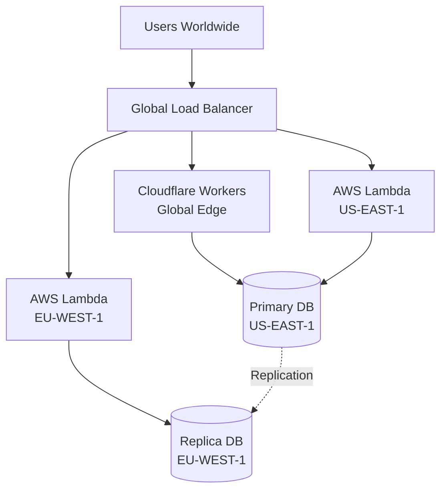
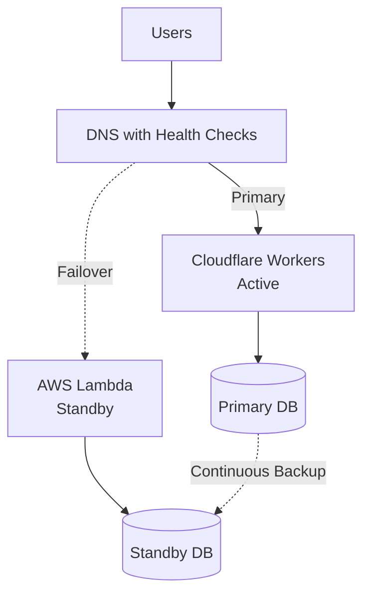

# Multi-Cloud Deployment

Run AuthHero across multiple cloud providers for high availability, geographic distribution, and resilience.

## Why Multi-Cloud?

- **High Availability** - Survive provider outages
- **Geographic Distribution** - Serve users from nearest location
- **Cost Optimization** - Use best pricing for each workload
- **Vendor Independence** - Avoid lock-in

## Architecture Patterns

### Active-Active (Global Distribution)

Deploy to multiple regions/providers simultaneously with traffic distributed globally.



**Use Cases:**

- Global user base
- < 100ms latency requirement
- 24/7 uptime critical

**Setup:**

1. **Deploy to multiple providers**

   ```bash
   # Cloudflare (edge)
   cd cloudflare && wrangler deploy

   # AWS US-EAST-1
   cd aws && sam deploy --region us-east-1

   # AWS EU-WEST-1
   cd aws && sam deploy --region eu-west-1
   ```

2. **Configure global load balancer**
   - Cloudflare Load Balancer
   - AWS Global Accelerator
   - Route 53 with geo-routing

3. **Set up database replication**
   - DynamoDB global tables
   - PlanetScale (MySQL) replication

### Active-Passive (Failover)

Primary in one provider, automatic failover to another.



**Use Cases:**

- Cost-sensitive deployments
- Disaster recovery requirement
- Less critical latency needs

**Setup:**

1. **Deploy primary and standby**

   ```typescript
   // Primary: Cloudflare Workers, on D1
   import { drizzle } from "drizzle-orm/d1";
   import createAdapters from "@authhero/drizzle";
   import * as schema from "@authhero/drizzle/schema/sqlite";
   import { init } from "authhero";

   export default {
     async fetch(request: Request, env: Env, ctx: ExecutionContext) {
       const { app } = init({
         dataAdapter: createAdapters(drizzle(env.AUTH_DB, { schema })),
       });
       return app.fetch(request, env, ctx);
     },
   };
   ```

   ```typescript
   // Standby: AWS Lambda, on DynamoDB
   import { handle } from "hono/aws-lambda";
   import { DynamoDBClient } from "@aws-sdk/client-dynamodb";
   import { DynamoDBDocumentClient } from "@aws-sdk/lib-dynamodb";
   import createAdapters from "@authhero/aws-adapter";
   import { init } from "authhero";

   const docClient = DynamoDBDocumentClient.from(new DynamoDBClient({}));
   const { app } = init({
     dataAdapter: createAdapters(docClient, { tableName: "authhero" }),
   });
   export const handler = handle(app);
   ```

   The standby only has current data if the primary's writes reach its database — see [Database Strategies](#database-strategies).

2. **Configure health checks**

   ```typescript
   // Add health endpoint to both
   app.get("/health", async (c) => {
     try {
       await dataAdapter.tenants.get("health-check");
       return c.json({ status: "ok" });
     } catch {
       return c.json({ status: "error" }, 503);
     }
   });
   ```

3. **Set up DNS failover**
   - Monitor `/health` endpoint
   - Automatic DNS switch on failure
   - 60-second TTL for fast failover

## Database Strategies

AuthHero keeps all state — users, sessions, refresh tokens, signing keys — in the data adapter. There is no separate session store, so every deployment that serves a tenant must read the same data, either from one shared database or from replicas you keep in sync.

### Option 1: One multi-region database

Use a database whose replication you trust, and point every deployment at it:

- **MySQL on PlanetScale** through the [Kysely adapter](/customization/kysely/):

  ```typescript
  import { Kysely } from "kysely";
  import { PlanetScaleDialect } from "kysely-planetscale";
  import createAdapters, { type Database } from "@authhero/kysely-adapter";

  const db = new Kysely<Database>({
    dialect: new PlanetScaleDialect({ url: process.env.DATABASE_URL }),
  });
  const dataAdapter = createAdapters(db);
  ```

- **DynamoDB global tables** through the [AWS adapter](/customization/aws-adapter/). DynamoDB replicates the table across regions; AuthHero does not coordinate the replication itself:

  ```typescript
  import { DynamoDBClient } from "@aws-sdk/client-dynamodb";
  import { DynamoDBDocumentClient } from "@aws-sdk/lib-dynamodb";
  import createAdapters from "@authhero/aws-adapter";

  const docClient = DynamoDBDocumentClient.from(new DynamoDBClient({}));
  const dataAdapter = createAdapters(docClient, { tableName: "authhero" });
  ```

Other multi-region SQL databases (CockroachDB, Aurora PostgreSQL) are not supported by the built-in adapters.

### Option 2: Independent databases with mirrored writes

Give each provider its own database and mirror writes to the others with `createPassthroughAdapter` from `@authhero/adapter-interfaces`. Reads come from the primary; writes go to the primary first and are then copied to each secondary:

```typescript
import { drizzle } from "drizzle-orm/d1";
import { DynamoDBClient } from "@aws-sdk/client-dynamodb";
import { DynamoDBDocumentClient } from "@aws-sdk/lib-dynamodb";
import { createPassthroughAdapter } from "@authhero/adapter-interfaces";
import createDrizzleAdapters from "@authhero/drizzle";
import * as schema from "@authhero/drizzle/schema/sqlite";
import createAwsAdapters from "@authhero/aws-adapter";

const primary = createDrizzleAdapters(drizzle(env.AUTH_DB, { schema }));
const backup = createAwsAdapters(
  DynamoDBDocumentClient.from(new DynamoDBClient({ region: "eu-west-1" })),
  { tableName: "authhero-backup" },
);

const dataAdapter = {
  ...primary,
  users: createPassthroughAdapter({
    primary: primary.users,
    secondaries: [
      {
        adapter: backup.users,
        onError: (error, method) => console.error("mirror failed", method, error),
      },
    ],
  }),
};
```

Mirroring is per entity and best-effort: a secondary write that fails is reported to `onError` and not retried. See [Adapters → Layering adapters](/architecture/adapters#layering-adapters).

## Session Management

Sessions, login sessions and refresh tokens are stored through the data adapter, and tokens are signed with the tenant's keys from the `keys` adapter. A deployment can therefore continue a session started on another deployment only if it reads the same data — which the database strategies above provide. No extra session store or shared JWT secret is needed or supported.

## Traffic Routing

### Geographic Routing

Route users to nearest deployment:

**Cloudflare Load Balancer:**

```javascript
{
  "pools": [
    {
      "id": "cloudflare-edge",
      "origins": ["workers.cloudflare.com"],
      "enabled": true
    },
    {
      "id": "aws-us-east",
      "origins": ["auth-us.example.com"],
      "enabled": true
    },
    {
      "id": "aws-eu-west",
      "origins": ["auth-eu.example.com"],
      "enabled": true
    }
  ],
  "geo_steering": {
    "policy": "geo"
  }
}
```

**Route 53 Geolocation Routing:**

```bash
aws route53 change-resource-record-sets \
  --hosted-zone-id Z123456 \
  --change-batch file://geo-routing.json
```

### Weighted Routing

Gradually shift traffic:

```javascript
{
  "weights": {
    "cloudflare": 50,  // 50% of traffic
    "aws-us": 30,      // 30% of traffic
    "aws-eu": 20       // 20% of traffic
  }
}
```

**Use for:**

- Blue-green deployments
- Canary releases
- A/B testing
- Gradual migration

## Cost Optimization

### Tiered Strategy

Use cheapest provider for each workload:

```
User Request
     │
     ▼
┌────────────────────┐
│ Cloudflare Workers │ ◀─ Authentication (cheapest, fastest)
│ Edge Layer         │
└────────────────────┘
     │ Heavy operations
     ▼
┌────────────────────┐
│ AWS Lambda         │ ◀─ Batch jobs, email sending
│ Regional Layer     │
└────────────────────┘
     │ Database
     ▼
┌────────────────────┐
│ Primary Database   │ ◀─ DynamoDB, PlanetScale or D1
│ Data Layer         │
└────────────────────┘
```

**Cost Breakdown:**

| Workload            | Best Provider | Monthly Cost (est.) |
| ------------------- | ------------- | ------------------- |
| Auth requests (10M) | Cloudflare    | $5                  |
| Database (100GB)    | DynamoDB      | $100                |
| Email sending       | AWS SES       | $10                 |
| File storage        | R2/S3         | $5                  |
| **Total**           |               | **$120**            |

Compare to single-provider: ~$200/month

## Monitoring

Monitor each deployment separately:

```typescript
// Add provider tag to logs
app.use("*", async (c, next) => {
  c.set("provider", process.env.PROVIDER); // "cloudflare" | "aws"
  await next();
});

// Centralized logging
app.use("*", async (c, next) => {
  const start = performance.now();
  await next();

  await analytics.track({
    provider: c.get("provider"),
    path: c.req.path,
    duration: performance.now() - start,
  });
});
```

**Tools:**

- Datadog - Multi-cloud monitoring
- New Relic - Application performance
- Grafana Cloud - Metrics aggregation
- Sentry - Error tracking

## Example Configurations

### Cloudflare Primary + AWS Backup

The Cloudflare Worker serves traffic from D1 and mirrors writes to DynamoDB with the passthrough adapter shown in [Option 2](#option-2-independent-databases-with-mirrored-writes). The AWS deployment reads the DynamoDB copy and takes over through DNS failover:

```typescript
// aws/src/index.ts
import { handle } from "hono/aws-lambda";
import { DynamoDBClient } from "@aws-sdk/client-dynamodb";
import { DynamoDBDocumentClient } from "@aws-sdk/lib-dynamodb";
import createAdapters from "@authhero/aws-adapter";
import { init } from "authhero";

const docClient = DynamoDBDocumentClient.from(new DynamoDBClient({}));
const { app } = init({
  dataAdapter: createAdapters(docClient, { tableName: "authhero-backup" }),
});

export const handler = handle(app);
```

### AWS Multi-Region Active-Active

Deploy the same Lambda to each region against a DynamoDB global table:

```typescript
// src/index.ts — deployed unchanged to us-east-1 and eu-west-1
import { handle } from "hono/aws-lambda";
import { DynamoDBClient } from "@aws-sdk/client-dynamodb";
import { DynamoDBDocumentClient } from "@aws-sdk/lib-dynamodb";
import createAdapters from "@authhero/aws-adapter";
import { init } from "authhero";

const docClient = DynamoDBDocumentClient.from(new DynamoDBClient({}));
const { app } = init({
  dataAdapter: createAdapters(docClient, { tableName: "authhero" }),
});

export const handler = handle(app);
```

## Testing Multi-Cloud

Verify failover works:

```bash
# Primary health check
curl https://auth.example.com/health

# Simulate primary failure
# (disable primary in load balancer)

# Verify traffic fails over
curl https://auth.example.com/health
# Should return 200 from backup

# Check latency from different regions
curl -w "@curl-format.txt" https://auth.example.com/health
```

## Migration Guide

Moving from single-cloud to multi-cloud:

1. **Phase 1: Add monitoring**
   - Set up health checks
   - Configure alerting
   - Baseline metrics

2. **Phase 2: Deploy standby**
   - Deploy to second provider
   - Set up database replication
   - Test failover

3. **Phase 3: Enable routing**
   - Configure load balancer
   - Start with 1% traffic to new provider
   - Monitor errors

4. **Phase 4: Scale up**
   - Gradually increase traffic
   - Add more regions
   - Optimize costs

## Best Practices

1. **Same configuration everywhere**
   - Use environment variables
   - Keep code identical
   - Automate deployments

2. **Test failover regularly**
   - Monthly failover drills
   - Automated testing
   - Document procedures

3. **Monitor everything**
   - Centralized logging
   - Cross-provider metrics
   - Alert on anomalies

4. **Plan for eventual consistency**
   - Design for it
   - Handle conflicts
   - User-visible state

5. **Keep it simple**
   - Start with two providers
   - Add complexity as needed
   - Don't over-engineer

## Next Steps

- [Cloudflare deployment](./cloudflare)
- [AWS deployment](./aws)
- [Widget assets configuration](./widget-assets)
- [Database adapters](/architecture/adapters)
